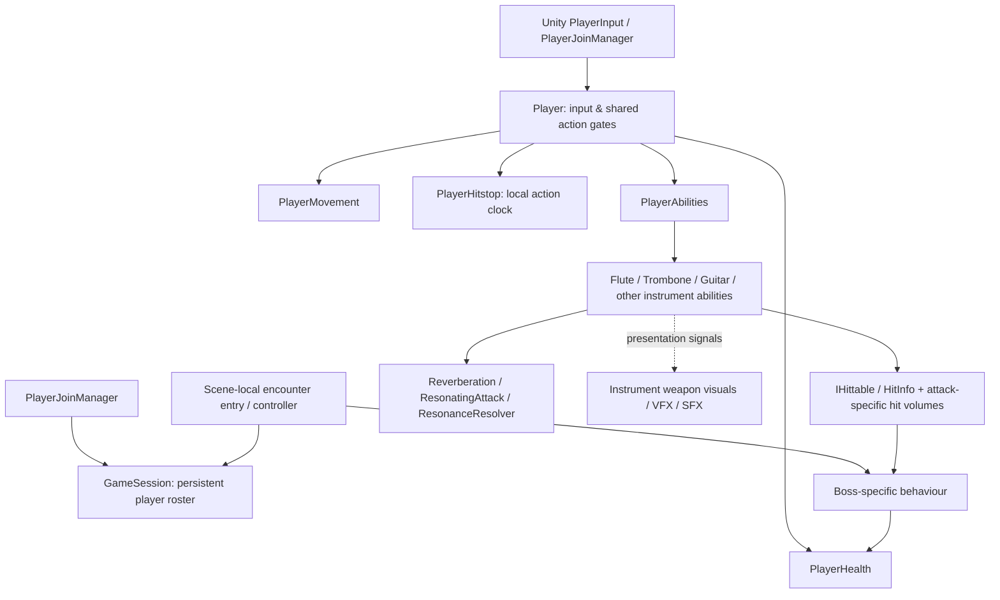

# Crescendo — Architecture and Collaboration Contract

**Status:** team baseline (v1)  
**Applies to:** Unity 6000.3.24f1 / URP, `Game50033`  
**Purpose:** a shared, practical architecture for six developers and their coding agents. This document describes both the desired long-lived design and how to adopt it from the existing project without a disruptive rewrite.

> **Principle:** stable responsibilities and contracts matter more than the number of classes. Build vertical slices, keep ownership localized, and introduce abstractions only when at least two concrete features need them.

## 1. Non-goals and invariants

- This is a **local** 2–4 player co-op boss-rush game. Do not design networking/replication infrastructure unless the scope changes.
- Shared player mechanics use **composition**. Instrument classes derive from `PlayerAbilities`; they do **not** derive from `Player`.
- The game is played on the **XZ plane** with a fixed, angled camera. Character/weapon sprites may be oriented in XZ. Do not silently switch to 2D physics or XY-space assumptions.
- The current player input behaviour (held abilities can retry, movement-facing fallback, dodge invulnerability through active dodge) is intentional until a design task changes it.
- Character animation is intentionally light. **Every instrument has a floating visual weapon component**, with instrument-specific motion carrying much of the attack readability. Keep the shared `Player` independent of the weapon animation implementation.
- Four people may attack simultaneously. Prioritize legible attack areas, target feedback, and restrained ambient VFX.
- **Not every architectural box needs a MonoBehaviour or manager.** Do not create empty systems just to match a diagram.

## 2. Responsibilities and dependencies



**Dependency rules:**

- **Player:** orchestrates per-player input, common action permissions, aim/target direction, and references to shared player components. No Guitar/Trombone/Flute conditionals.
- **PlayerMovement:** the sole authority for *physical player movement* via `CharacterController` (walking, dodge, and future skill-driven displacement). Ability scripts request motion; they must not move the player via `transform.position`.
- **PlayerHealth:** owns HP, damage acceptance/invulnerability, downed timer, automatic revival, and health-related notifications. Reviving needs no teammate input.
- **PlayerAbilities:** abstract contract (`TryUsePrimary`, `TryUseSecondary`, `TryUseDefensive`, `TryUseSpecial`, `Cancel`) and class-controlled restrictions (`BlocksMovement`, `BlocksDodge`, `BlocksAbilities`). Restrictions may change during individual attacks. `AnimationPhase` exposes `PlayerAttackPhase` (None/Windup/Active/Recovery), defaulting to None; it is a presentation view of ability timing, not a second timing authority. `MovementSpeedMultiplier` defaults to 1 and allows an ability to slow walking without modifying dodge or skill displacement.
- **Instrument implementation:** owns attack timings, cooldowns, hitboxes/projectiles, class resources, and its own weapon visual implementation (e.g. `GuitarWeaponVisual : FloatingWeaponVisual`). It should depend on the shared player API and shared combat contracts, not other instruments' internals.
- **GameSession:** persistent roster of participating `Player` objects, with registration/unregistration and roster notifications. It is not responsible for boss AI, lobby selection, or camera effects.
- **PlayerJoinManager:** creates/configures player instances and owns joins, leaves, and device pairing. Other gameplay code should **not** depend on this class merely to find players.
- **LobbyManager / character selection:** controls lobby selection and spawning of the chosen prefab. It owns lobby-only state; runtime player identity belongs to the surviving player instance.
- **Encounter entry/controller (when added):** scene-local encounter setup, spawn points, fight start/end and win/loss conditions. Boss AI should be independent of lobby/scene transition implementation.
- **Boss-specific scripts:** targeting, movement, attack patterns and phase behaviour. Read active players from `GameSession` or context supplied by the scene entry; avoid hardcoded player GameObjects and `PlayerJoinManager` dependencies.
- **Presentation:** animation, floating weapons, VFX, SFX, HUD. Presentation listens to gameplay events or explicit calls. It must not define authoritative damage, cooldown, or hit outcomes.

Coupling to a fitting owner (e.g., boss → roster, Guitar → PlayerMovement) is acceptable. Do **not** add interfaces or an event bus just to eliminate every reference.

## 3. Scene and object lifetime

### Recommended baseline — multiple encounter scenes, persistent players

Use **one scene per independently developed boss encounter**. Maintain the current lobby-to-game flow while extending it to more encounter scenes:

```text
Lobby.unity -> Cutscene1.unity -> Game.unity (current first playable encounter)
                                      |
                                      +-> later Encounter_Boss02.unity, ...
```

- The existing `GameSession` plus `PlayerJoinManager` live on a persistent manager root. Joined player roots (with `PlayerInput`) also survive scene transitions. This retains device pairing, player indices, and selected instrument instances.
- **Current implementation uses `DontDestroyOnLoad` and ordinary scene loading.** Keep it for now. Separate boss scenes do **not** require a new `Core.unity` scene or mandatory additive loading. Additive loading is an option later for persistent shared environments or simultaneous streamed scenes, not a prerequisite.
- Bosses, arena geometry, hazards, scene lighting, arena-specific UI, and encounter scripts are **scene-local** and get destroyed when their encounter is unloaded.
- An encounter scene has one entry point (currently `GameSceneEntry` for `Game.unity`) that positions surviving players, restores input, and supplies encounter-specific references as needed. Don't repeat a `FindObject...` lookup every boss update.
- Do not serialize cross-scene references from encounter assets to persistent roots; resolve/inject them at runtime. Boss code can receive the roster/session via encounter initialization or a one-time lookup through the current player. No global singleton required.
- Define reset rules explicitly before a second fight exists: HP, cooldowns, active projectiles/REV entities, attack restrictions, and boss state must start in a known condition. Preserve device pairing and selected instrument.
- Keep existing `SceneNames` / Build Profiles accurate whenever a scene is renamed or added. If a boss scene is meant to work standalone in the Editor, provide test initialization rather than duplicating persistent managers in production prefabs.
- The team-wipe/defeat condition is a *game-design decision* and intentionally not prescribed here; downed players currently auto-revive on a timer.

### Lifecycle ownership reference

| State | Owner | Survives encounter scene change? |
|---|---|---|
| Device pairing, player index | `PlayerInput` / persistent player | Yes |
| Selected instrument / character identity | Player + character selection data | Yes |
| Player roster | `GameSession` | Yes |
| HP/cooldowns | Player components; reset at encounter boundary | Object persists; values reset by policy |
| Boss AI, phases, projectiles, arena hazards | Encounter scene | No |
| Lobby selection UI | Lobby scene | No |
| Weapon visuals | Instrument/player prefab | Yes; visuals reset with player |

## 4. Shared gameplay and combat contracts

### Player API

Prefer these existing public boundaries over inspecting private state or finding objects:

- `Player.Movement`, `.Health`, `.Abilities`, `.Hitstop`, `.Session`, `.Character`, `.PlayerIndex`, `.AimDirection`, `.GetAttackDirection(...)`.
- `Player.CanMove`, `.CanDodge`, `.CanUseAbilities` are the shared action gates; instruments determine their own temporary restrictions via `PlayerAbilities`.
- `PlayerHitstop` is a small shared component on `Player.prefab`, exposed through `Player.Hitstop`. `Request(duration)` keeps the longer remaining pause; `IsStopped` reports it. `ActionTime` / `ActionDeltaTime` form a per-player action clock. `Player.Update` ticks it once before input and movement, consuming only the paused portion of a frame and never catching up discarded time. It uses scaled Unity delta time so an ordinary game pause also stops this clock/countdown. It never changes global `Time.timeScale`. `Clear()` ends the pause without rewinding action time. Player down/disable and component disable clear it; Guitar cancellation also clears its own pause. No singleton, event bus or `IHittable` change is involved.
- Hitstop blocks new movement/dodge/ability actions through existing Player gates. Movement still recharges dodge charges using world time, but skips physical movement while stopped and uses action time for skill-displacement timestamps. Guitar phase timestamps use action time while cooldown/combo deadlines remain on world time. Weapon interpolation uses action delta time: the impact pose can display on its request frame, followed by held frames. Guitar smear poses use the same action clock and hold during hitstop. Existing independent world effects (including impact particles and launched projectiles), health/revival/immunity timers, enemies and other players keep their normal clocks. Hitstop itself grants no invulnerability. Future melee classes opt in by requesting a pause and using the local clock for their action/animation; ranged attacks must not request attacker hitstop.
- `PlayerMovement` owns dodge charges, the active dodge, and physical movement. `TryStartDisplacement(direction, distance, duration, easing, delay = 0)` requests one XZ displacement; it returns false if movement/controller is unavailable or another dodge/displacement is active. The optional delay aligns a lunge with an attack windup on the same per-player action clock. Standalone movement components without `PlayerHitstop` retain the world-time fallback. `Tick(deltaTime, canMove, movementSpeedMultiplier = 1)` combines permitted walking at the supplied multiplier (nonnegative) with a skill's fixed displacement, including during its delay. An ability that requires a full movement lock must still set `BlocksMovement`; the multiplier does not bypass that gate. Dodging suppresses walking for its entire duration, including its final tick. `CancelDisplacement()` stops pending or active motion. Downing, disabling the player/movement, or disabling the controller cancels it. A displacement does not grant invulnerability.
- `PlayerAnimation` is presentation-only, wired on the base player prefab with its child Animator, CharacterController, PlayerHitstop and shared `Assets/Tuning/Players/PlayerAnimationTuning.asset`. It samples actual horizontal controller velocity after player movement, sends `Moving` and run-threshold-normalized `Speed` parameters, and holds Animator playback during local hitstop. The controller owns immediate Idle/Walk/Run transitions and held attack-pose overrides; it does not control movement or damage. `PlayerAnimation` samples after Guitar abilities (execution order 200), forwards their `AnimationPhase` as the integer `AttackPhase`, and updates that parameter even when hitstop holds playback so the impact pose can appear on its first stopped frame. Other instruments retain locomotion until they opt into this shared property. Animation clips under `Assets/Gameplay/Players/Animation/` author the sprite sequences and 8 FPS playback: Idle 0–1, Attack 4–5, TakeDamage 6–7, Walk 8–11, Run 12–15, Jump 24–31 and Death 36–39. Only Idle/Walk/Run loop. Additional single-frame AttackWindup, AttackActive and AttackRecovery clips hold literal sheet frames 4, 2 and 0. Any State transitions select these poses from the phase parameter; completion or cancellation returns to Idle, then normal movement selection. Guitar Primary and Secondary derive the phase from their existing snapshotted windup/active durations and action-clock timestamps, without changing gameplay timing or movement. The original Attack/TakeDamage/Jump/Death clips remain prepared without gameplay transitions. Thresholds are centralized in the tuning asset; frame sequences and playback timing are edited through Unity’s Animation window. Existing character tint and projected sprite material are preserved.

- `PlayerHealth` owns damage/downing/revival. Do not implement alternative HP fields inside instrument classes.
- `PlayerAbilities` methods are invoked while held where applicable. Individual abilities own whether a press, hold, charge, or release is meaningful. Extend input exposure through `Player` only when needed; do not read other players' global input assets.
- `Player` applies character art/tint only to its serialized avatar renderer. Instrument weapon renderers retain their own art and materials. Older standalone prefabs without that reference fall back to their first child sprite renderer.

### Guitar Primary, Secondary and weapon presentation

- `GuitarTuning` holds Attack, Secondary, Weapon and VFX sections in the single shared asset `Assets/Tuning/Instruments/Guitar/GuitarTuning.asset`. `GuitarAbilities`, `GuitarWeaponVisual` and `GuitarVFX` each reference it directly. The asset contains configuration only, including the impact prefab asset; per-instance renderer/transform wiring and runtime state remain on components. Missing tuning is reported once when a component enables, and that component disables instead of silently using fallback values.
- `FloatingWeaponVisual` defines only `Cancel()`. Pose APIs stay instrument-specific until a second weapon needs the same operations.
- `GuitarAbilities` owns a three-strike Primary string. Each held-input retry can start the next strike after recovery; a pause resets the string and finishing the third strike adds the combo cooldown. Each strike snapshots the existing auto-targeted `Player.AimDirection` on activation, locks dodge/other abilities, and requests a delayed lunge from `PlayerMovement`. Guitar overrides `MovementSpeedMultiplier` with Attack's `movementSpeedMultiplier` (default 0.2) throughout Primary's windup, active and recovery. `Player` forwards the active ability's multiplier into movement each tick, otherwise using 1. Primary allows walking at this reduced speed even when lunge distance is zero, and independently adds the original fixed-direction lunge during Active. Finishing, cancelling, downing or disabling restores the normal multiplier. Secondary selects its own independently tuned multiplier.
- Secondary Strum stays in `GuitarAbilities`: it snapshots aim, slows walking and briefly locks dodge/other actions, launches a `GuitarStrum`, and refreshes the combo continuation window without changing the pending Primary step. It requests a backward displacement from `PlayerMovement` opposite the captured aim, delayed until release and lasting through the active phase. Windup, Active and Recovery are separate durations: the wave launches at Active's start, the sweep/backstep completes during Active, and Recovery settles the weapon before actions unlock. Projectile lifetime remains independent. Distance and easing are Secondary tuning fields; cancellation/downing cancels this motion through the existing shared path. Secondary's `movementSpeedMultiplier` (default 0.2) applies throughout all three phases, including casts with zero backstep distance. Live slowed walking adds to the original captured-direction backstep through shared movement, preserving wall collision. Completion, cancellation, downing and disable release the slowdown. It has its own cooldown and can occupy the finisher's Primary cooldown. `IsAttacking` covers both actions; `IsStrumming`, `HasEmpoweredPrimary` and `SecondaryCooldownRemaining` expose the small additional state. Empowerment is granted on launch, independent of hits, has no expiry, does not stack, and is consumed only when a Primary activation succeeds. The snapshotted multiplier applies to that entire strike, including sweet spots; a missed strike still spends it. `Cancel()` clears empowerment and either active action, without destroying previously launched waves.
- `GuitarStrum` owns scene-local projectile movement, snapshotted geometry/damage, swept curved-front queries, per-wave target deduplication and wall/lifetime termination. Distance, duration and movement/growth/fade curves define its expansion and slowdown. Queries sweep the combined per-spoke translation and radial growth, comparing collision fractions before accepting enemy hits, so an expanding front cannot skip a target or pass through a thin wall between frames. It ignores players, pierces enemies once each, resolves the nearest wall before targets behind it, and continues after its caster is downed. Instantiate it without parenting to the persistent player. `GuitarStrumVisual` receives that same geometry and updates the leading crescent from that same radius and tip taper, plus a cosmetic fragmented tail. Mesh topology and buffers are reused across frames. It never applies damage. The visual uses its dedicated `GuitarStrum.mat` / `GuitarStrum.shader` on `PixelWorldVFX`, with warm body/rim/tail colours, hard colour bands, moving chunky tail breakup and stepped opacity supplied by the shared tuning asset. Its bright rim is cosmetic for this uniformly damaging projectile; Primary's smear shader is unchanged. Neither Secondary nor its wave implements REV/RES yet. Future Guitar Special and Defensive should follow the same pattern: independently tuned slowed walking throughout their animations, with any skill displacement added separately. They remain unimplemented.
- Damage resolves once across the complete XZ annular sector at a configurable impact delay after the active phase starts. `GuitarAbilities` snapshots the current player position after movement, aim, full angles, inner/outer radii, sweet-spot radius and arena-space stretch, and passes that same data to presentation. Overlapping radial capsule queries cover the sector; contact filtering prevents capsule thickness from extending its XZ boundaries. Targets are deduplicated per strike, so one target can take three hits across a full string. There is no dependency on the sprite transform, VFX mesh or physics trigger callbacks. Later lunge travel and afterimages do not move or repeat the damage area. Each strike has a reach multiplier (defaults 1 / 1 / 1.4); reach and sweet-spot radius scale together. Attack settings define a fixed world-XZ stretch axis and Depth Stretch multiplier (default world Z and 1.5). Hit queries and gizmos stretch the sector along that axis; contact filtering applies its inverse before checking radius/angle and sweet-spot membership. The inner hole and sweet-spot boundary stretch with the outer edge. The attack geometry remains fixed in world space for the strike. Targets with `CombatHurtbox` use the projected query described below; the remaining targets keep world-space detection. The outer radial region applies a configurable sweet-spot damage multiplier. After both projected and legacy targets are resolved, a successful Primary requests the maximum applicable normal/sweet hitstop duration from the current combo entry (normal/sweet defaults: first 0.04 / 0.06, second 0.05 / 0.075, third 0.06 / 0.09 seconds) once for the sweep. Requests do not sum across targets, do not occur on misses or Secondary/projectile hits, and do not interrupt resolving the other targets in that impact. `IHittable`/`HitInfo` remain unchanged; Primary has no REV/RES interaction.
- `GuitarWeaponVisual` handles a wielded shoulder pose, anticipation, swing and recovery. The resting guitar body starts opposite movement facing, then applies Weapon's `restingAngleOffset` (default 20 degrees) clockwise in the gameplay camera plane. Left-facing directions mirror that offset counterclockwise, including left-side diagonals; exactly vertical screen-facing directions use clockwise (with a small numerical tolerance around zero horizontal component). `shoulderLift` is removed. Idle geometry projects the smoothed visible direction back onto XZ along view rays, keeping the underlying weapon axis consistent without a second smoothing step. Attack poses retain their original angles and smoothing. Its grip anchor sits near the player. Weapon tuning separates `restingGripPoint` (default `(0, 0.1)` in the grey neck) from `spriteGripPoint` (Inspector label Attack Grip Point, original `(0, 0.45)` outside the sprite). Windup blends the grip using the existing position response; Active uses the exact external pivot. The sprite offset and shader pivot always receive the same interpolated value. Returning to idle blends back to the neck. Follow-through is retained between combo strikes and blends back to the shoulder pose when the string finishes, times out or is cancelled. The sprite faces the camera and rotates in that plane; sweep angles still come from XZ gameplay. It uses `2DSpriteMat`: `_SpriteRotation` and `_SpritePivot` rotate the visible camera-facing image about the grip, while `_SpriteFlatDepth` projects depth onto the geometry's horizontal plane. All three properties default to zero, preserving existing avatar projection and depth. The weapon no longer faces its transform toward the camera or applies a camera-depth lift. The weapon sprite stays on the full-resolution `SpriteVisual` layer. `GuitarPlayer.prefab` wires an authored resting material and the original attack material. Idle uses `Art/GuitarRestingWeapon.mat`, a copy of `2DSpriteMat` at render queue 2449 with ForwardLit ZWrite disabled; avatar sprites at queue 2450 then cover the whole resting guitar wherever they overlap. This intentionally applies to other players' bodies too. World depth testing and the existing flat-depth projection remain enabled, so world geometry occludes the weapon and the floor does not cut through downward artwork. All posed phases and held follow-through retain the original attack material/depth behavior. Runtime code switches shared material references without cloning or mutating them.
- Strum uses `GuitarWeaponVisual.SetSwingPose`, with a windup and a configurable sweep angle/easing during Active, followed by a separate Recovery using Attack's recovery easing. It retains its own follow-through when a Primary combo is pending, otherwise blends back to idle. There is no separate playing/vibration pose mode or torso-anchor tuning. Presentation does not move the player or change damage timing.
- `GuitarVFX` receives the impact snapshot and immediately displays its full sector, followed by four timed, held poses: broad slash, follow-through, broken crescent and remaining streaks. Pose durations use the owning `PlayerHitstop.ActionTime` independently of rendering FPS, so the current mesh pose/lifetime holds during hitstop and resumes without catching up world time. Standalone VFX without that component retain world-time timing. Weapon motion remains continuous outside hitstop, while damage occurs only at the initial pose. `GuitarSmear.shader` uses hard body/sweet-spot color bands and clipped breakup rather than interpolated colors or alpha fading. The mesh uses the supplied stretch and the shader applies its inverse before measuring distance against the sweet-spot radius, using the same fixed impact origin and shape as damage. Each smear carries its own axis and inverse stretch in UV2, so overlapping effects do not share mutable shape parameters. The initial mesh has no separate reach, inner-radius or onset overrides; decorative edge clipping and subsequent afterimage shapes are presentation only. Pose 3 has a flat leading edge and a torn trailing edge in either swing direction. Each swing carries its own pose data, allowing independent overlapping effects. `GuitarVFX` owns/releases the runtime mesh; cancellation/disable clears it. Both it and the test dummy restore their native-backed property blocks in `OnEnable` so Play-mode script reloads cannot leave null blocks and flood the Console. Scene-local impact particles remain independent, and gameplay works with presentation disabled or absent.
- `Abilities/Guitar/Prefabs/GuitarPlayer.prefab` is a variant of the shared Player prefab with the placeholder `PlayerCombat` removed. `Character_Guitar.asset` selects it through the existing lobby flow. `Scenes/TestScenes/GuitarPrimaryTest.unity` provides three damage dummies and Guitar/Flute prefab overrides for local testing. `GuitarDamageDummy` is a feature-local test target, not a new combat contract.

### Pixel-art world effects

- `PixelArtRendererFeature` renders opaque world geometry and its outlines first, then selected transparent effects into the same low-resolution color target before nearest-neighbour upscaling. Transparent effects retain their materials and alpha blending, sort back-to-front, and test against opaque depth with depth writes disabled. They do not contribute to the outline calculation.
- `PixelWorldVFX` (GameObject layer 12) is the explicit opt-in layer for transparent effects that should pixelate. Assign an effect's renderer child to this layer; keep gameplay colliders on their existing layers. The Guitar `SlashSmear` is the initial user of this policy. Its impact particles have not been opted in.
- `PC_Renderer.asset` sets the feature's `transparentWorldLayers` to `PixelWorldVFX` and excludes that layer from URP's regular Transparent Layer Mask. Both masks must stay in sync so these effects render exactly once. Existing `Default` transparencies retain their full-resolution path.
- `SpriteVisual` (layer 11), other full-resolution transparencies and UI remain in their existing paths. Full-resolution transparent sprites draw after low-resolution effects; these two groups do not share one global transparent sorting order. Test their overlap when authoring new effects.

### Centralized tuning

- **All authored feature tweaks belong in ScriptableObject assets under the top-level `Assets/Tuning/` folder.** This includes gameplay values (damage, reach, timings, cooldowns, movement and health settings) and presentation values (weapon offsets, animation curves, smear pose durations, colors and effect sizes). Designers should not have to search prefab variants or scene instances to adjust these values.
- Group assets by ownership, for example `Assets/Tuning/Players/PlayerTuning.asset`, `Assets/Tuning/Instruments/Guitar/GuitarTuning.asset` and `Assets/Tuning/Bosses/Bone/BoneTuning.asset`. The Guitar asset exists; the Player and Bone paths are placement examples for future scoped migrations. Use separate assets for independently owned features to limit merge conflicts. A feature's related components can share one asset with clearly named serializable sections; do not require one asset per component or combine the entire game's settings into one asset.
- Keep the ScriptableObject C# type beside its owning feature code. Each consuming component holds a serialized reference to the appropriate asset. Avoid a global settings singleton, runtime asset searches or a generic configuration framework.
- The asset is the single source for each tuning value. Do not retain parallel prefab/scene values or silent fallback configurations that make it unclear which setting is in use. Preserve the current authored values when migrating a feature, including any intentional variant differences through explicitly assigned assets.
- Prefabs/scenes retain per-instance wiring such as renderers, transforms, colliders and scene object references. Runtime state such as HP, cooldown countdowns, combo progress and active effects stays on component instances; gameplay must not write that state into a shared tuning asset.
- Sharing configuration does not change responsibility: gameplay owns the authoritative hit area and timing, while presentation reads the supplied attack data. A VFX tuning section must not become an independent source for damage reach or sweet-spot thresholds.
- This is the convention for new work and explicitly scoped migrations. Guitar has been migrated; other existing components still store tuning on prefabs until migrated; this documentation does not authorize a project-wide rewrite or creation of placeholder tuning assets.

### Hits and damage

- `CombatHurtbox` is an opt-in 3D capsule definition on the same GameObject as an `IHittable`. Its optional Anchor is per-instance wiring. `CombatHurtboxTuning` assets under `Assets/Tuning/Combat/` own local-space Center, Radius and total Height along local Y. Anchor rotation and scale apply: radius uses the larger absolute X/Z scale, height uses absolute Y scale, and height below the diameter produces a sphere. The three Guitar test dummies share `GuitarTestDummyHurtbox.asset`. The capsule is mathematical geometry, not an additional physics collider; world collision is unchanged.
- Both Editor previews draw without selection and respect each viewport's Gizmos menu / `CombatHurtbox` toggle. Scene view draws the yellow 3D capsule; Game view draws its cyan orthographic silhouette only when the shared tuning asset's `showGameViewPreview` is enabled (default false). This debug flag does not affect queries or Scene-view drawing. The silhouette is moved along view rays towards the near plane to stay visible over artwork without changing its screen position. Disabled components draw neither. Both use the same world capsule endpoints/radius as hit detection, with no debug-only dimensions or runtime renderers.
- `CombatHurtbox.Active` exposes the enabled shapes; components register/unregister on enable/disable. This small registry is needed because world-space overlap queries would discard valid projected overlaps. It is not a combat manager and never applies damage. `TryOverlapSector(camera, origin, direction, innerRadius, outerRadius, angle, stretchAxis, stretch, out contact)` projects the 3D capsule endpoints onto the orthographic camera plane, retaining its round cross-section radius. This produces the exact projected capsule, including a circle when viewed along its axis. The existing capsule/triangle overlap then compares it to the annular sector, using the initial crescent's four-degree tessellation in camera-plane world units. The query requires an angled orthographic camera. Contact is returned on the attack plane for feedback. It does not inspect rendered pixels, artwork, VFX or world occlusion.
- Guitar Primary snapshots that registry once at impact, applies its mask and player exclusions, checks the normal band first, then the sweet band, and deduplicates with the same per-strike set as legacy hits. Overlap spanning both bands gives normal damage. Objects with a hurtbox cannot also use their world colliders for Primary damage, even when their hurtbox is disabled. Targets without one retain their existing queries. This is an explicit camera-dependent combat rule: depth-separated shapes can hit when their projections overlap. Only Guitar Primary currently adopts it; Secondary, other instruments, bosses and REV/RES are not migrated incidentally. Enemy owners must align their authored capsule with the vulnerable visible body, including any custom sprite projection.
- Reuse existing `IHittable.TakeHit(in HitInfo)` for world entities that accept player attacks. `HitInfo` presently carries attacker, damage and direction. `BaseBoss` and `TrainingDummy` provide current examples.
- `PlayerHealth.TryTakeDamage(int)` is currently the authoritative player damage API. Boss attacks should go through it or a **small adapter**, not subtract health privately. If richer hit data becomes necessary for players, evolve the shared contract deliberately instead of creating another parallel damage system.
- Each attack owns its spatial query/collider and **deduplicates targets within one swing/projectile**. An attack can hit multiple valid targets where the move requires it.
- Gameplay determines hit success, damage and timing. Hitstop, knockback, camera shake and hit flash are *consequences* triggered after an accepted hit; visuals must not determine whether a hit occurred.
- A shared hit resolver is warranted **only if** repeated cross-cutting rules (hitstop, hit immunity, knockback, reactions) are otherwise duplicated across several attacks. Do not create a generic combat framework preemptively.
- Use layers and collision masks deliberately. A visual arc is not the source of truth for the hitbox; it should communicate the authoritative attack area.

### Reverberation / Resonance

The existing implementation already has useful contracts; preserve and build on them:

- `Reverberation`: temporary world entity with creator, effect, strength, availability and expiry.
- `ReverberationEffect`: effect definition; effects determine the outcome when consumed.
- `ResonatingAttack`: a compatible attack volume linked to its owning player.
- `ResonanceResolver`: validates and consumes a compatible REV, executes the effect, emits a notification.
- `AttackTargeting`: currently supports player attack targeting, including Reverberation selection. Its target-priority policy is **prototype behaviour**, not an architectural invariant.
- A player should not consume their own REV under the current design. Instruments create/exploit REV through these shared systems rather than hardcoding teammate class checks.
- Adding a new instrument should normally mean adding instrument-local attacks/effect assets and using the existing shared contracts; not editing `ResonanceResolver` for every new skill.

### Bosses

`BaseBoss` is currently a checkoff prototype; it combines targeting, health, visuals and a bone-projectile attack. **That is not the long-term shared boss API.** When implementing the next substantive boss feature:

1. Move Bone-specific attacks/graphics into a `Bone` boss feature directory.
2. Keep minimal common boss damage/health behaviour (possibly `BossHealth`) only if at least two bosses need it.
3. Have encounter setup supply the roster, or obtain it once from `GameSession`. Do not base the canonical roster on an arena detection trigger.
4. Separate boss attack behaviour from boss VFX, and keep each boss's balancing/configuration local.

Do this incrementally; do not break the existing checkoff demo just to reorganize code.

## 5. Feature-first folder structure

**Target structure, with `(new)` marking not-yet-required directories.** Existing paths are listed where important. Prefer moving feature-local assets together once ownership is clear; **do not move all assets at once.**

```text
AGENTS.md                            # Codex entrypoint (repository root)
README.md
docs/
  architecture_overview.md             # team-facing quick read
  agents/
    ARCHITECTURE.md                    # detailed reference for coding agents
Assets/
  Gameplay/
    GameSession.cs                      # existing; persistent player roster
    Players/
      Player.cs                         # shared player/input coordinator
      PlayerMovement.cs                 # walking/dodge/displacement
      PlayerHitstop.cs                  # per-player pause and action clock
      PlayerHealth.cs                   # downed/revive/health
      PlayerAbilities.cs                # abstract instrument contract
      FloatingWeaponVisual.cs          # common cancellation contract; concrete motion is instrument-specific
      PlayerJoinManager.cs              # join/leave/device pairing
      PlayerCharacterSelect.cs          # lobby-side player selection (existing)
      KeyboardGamepadBridge.cs          # existing input bridge
      Prefabs/
        Player.prefab                   # shared base prefab, owned centrally
        PlayerJoinManager.prefab        # persistent session root
      Abilities/
        Guitar/                         # abilities, tuning, weapon/VFX, Strum gameplay/visuals, test target
          Art/                          # guitar sprite and trail material
          Prefabs/                      # Guitar player variant and impact particles
        Flute/                          # existing Flute abilities, projectiles, flows
          Prefabs/
        Trombone/                       # target; currently Players/Trombone/
          Prefabs/
        Training/                       # temporary/testing abilities
    Combat/
      IHittable.cs                      # contains HitInfo today
      AttackTargeting.cs
      TrainingDummy.cs
      Resonance/
        Reverberation.cs
        ReverberationEffect.cs
        ResonatingAttack.cs
        ResonanceResolver.cs
        ...                             # specific effect types + prefabs
    Bosses/
      Shared/                           # (new if useful) cross-boss components
      Bone/                             # target for current Bone/BoneProjectile/assets
      <OtherBoss>/                      # one independently owned folder per boss
    Characters/
      CharacterDefinition.cs
      CharacterRoster.cs
      Data/                             # immutable-ish authored character definitions
    Lobby/                              # lobby UI, ready/start and selection rules
    Flow/                               # scene names, cutscene/transition utilities
    Game/                               # encounter entry / player spawn handoff
    UI/                                 # (new as needed) shared HUD and game UI
  Scenes/
    Lobby.unity                         # current path
    CutScenes/                          # current intro/placeholder cutscene
    Game.unity                          # current first playable encounter
    Encounters/                        # (new) later independent boss scenes
    TestScenes/                        # isolated integration/prototype scenes
  Art/                                  # shared art; per-feature art lives with feature
  Rendering/                            # global render features and shared shaders
  Settings/                             # Input Actions, URP and settings assets
  Tuning/                               # (new) central home for authored feature tuning assets
    Players/                            # shared movement, dodge and health tuning
    Instruments/                        # Guitar/, Flute/, Trombone/ tuning
    Bosses/                             # one subfolder per boss
  Examples/                             # temporary examples, not production dependencies
```

**Folder conventions:**

- Keep **feature-owned code, prefabs, art, VFX and non-tuning data assets close together**. Tuning ScriptableObject assets are the deliberate exception: collect them under `Assets/Tuning/` while keeping their C# types with the owning feature. Reusable cross-feature code lives under `Combat`, `Players`, `Rendering`, etc. Don't build a top-level `Scripts/` dumping ground.
- One primary C# type per file, matching filename. Use the existing `Game50033` namespace; nested namespaces are optional when they add clarity. Namespace is **not required** to mirror folders.
- Name gameplay scripts by responsibility (`GuitarAbilities`, `GuitarWeaponVisual`, `GuitarVFX`), not by arbitrary `Manager`/`Helper` suffixes.
- **Base player prefab** contains only player-common components. **Every instrument prefab variant has a concrete floating weapon visual component** (e.g. `GuitarWeaponVisual : FloatingWeaponVisual`), and its own effects. The common abstract base is a script contract, not a component attached directly to the base prefab.
- Data assets (`CharacterDefinition`, `ReverberationEffect`, balancing configs) describe configuration. Avoid mutable global state in shared ScriptableObject assets.
- Shared art/shaders belong in `Art`/`Rendering`; a one-off Guitar effect belongs in Guitar's feature folder.
- Keep test scenes separate from the scene used for integration/demo. Test features independently without re-saving the team-owned gameplay scene unnecessarily.

## 6. Integration and ownership for six people

Assign a **human owner for each shared surface**; the names can change, the boundaries shouldn't. Multiple people can implement features inside their own directories simultaneously.

| Workstream | Primary modification area | Shared touchpoints requiring coordination |
|---|---|---|
| Player foundation & Guitar | `Players` shared code, `Abilities/Guitar` | `Player.prefab`, input actions, `GameSession` |
| Other instrument 1 | `Abilities/Flute` | shared combat contracts only when necessary |
| Other instrument 2 | `Abilities/Trombone` | shared combat contracts only when necessary |
| Bosses & arenas | `Bosses/<Boss>` and its encounter scene | `IHittable`, encounter entry |
| Combat synergy & VFX | `Combat/Resonance`, shared effects | `ResonanceResolver`, hit contracts |
| Lobby, UI & integration | `Lobby`, `Flow`, `Game`, `UI`, integration scene | `PlayerJoinManager`, build profiles, scene transitions |

These are **workstream suggestions, not assignments of specific teammates**. One integrator should own the integration branch/demo scene and take responsibility for detecting conflicts early.

### Cross-system change protocol

1. Describe the required change in terms of an API/behaviour, identifying who consumes it.
2. Have the owner of the shared component update it in a small PR/commit; provide a stub or adapter if needed to unblock others.
3. Each feature author integrates against that API in their own files.
4. If the change alters an established boundary, update this document in the same PR.
5. Integrate small, playable increments frequently. Do not leave weeks of unrelated feature branches diverging.

### Unity Git conventions

- Commit `.meta` alongside its asset, preserving GUIDs during moves. Never rely on another developer recreating an untracked folder or asset.
- Set up UnityYAMLMerge locally as described in `README.md`. It reduces, but does not eliminate, conflicts.
- Coordinate edits to the same `.unity`, base `.prefab`, `.inputactions`, shared `.shadergraph`, and Build Profiles. Prefer feature-specific prefabs and individual test scenes.
- Keep code reviews focused on architecture and behaviour rather than unsolicited wholesale formatting.
- Don't move or rename files while a teammate is actively modifying those same assets. Separate organization-only changes from gameplay changes where practical.

## 7. Implementation plan — adopt without stopping development

This is a **migration order**, not a required single giant refactor:

**Now (same day):**

1. Commit `AGENTS.md` and this document so agents and developers share the rules.
2. Designate ownership of `Player.prefab`, `PlayerJoinManager.prefab`, input actions, the shared combat contract, and the integration scene.
3. Keep the current `Lobby → Cutscene1 → Game` checkoff/demo flow running. Identify a minimal integration/playtest scene as the reference build.
4. New Guitar work goes straight into `Players/Abilities/Guitar` and its own variant/VFX assets. Use `IHittable`, `HitInfo`, and the existing Resonance APIs.

**As the next feature touches each area:**

5. Move `Players/Trombone/` into `Players/Abilities/Trombone/` with metadata intact, coordinated with the Trombone owner.
6. Move Bone-specific scripts, prefabs and animations under `Bosses/Bone/`; trim concrete attack logic out of `BaseBoss` only if the second boss exposes genuine duplication.
7. Add `Scenes/Encounters/` and a scene-local encounter entry/controller when a second boss scene is created. Preserve persistent players and device pairing across scenes; reset encounter-specific state explicitly.
8. Separate any presentation code that currently decides hits/damage, as it is encountered during VFX work.
9. Replace prototype class-specific exceptions in shared targeting with stable abstractions **only when** multiple instruments/bosses need them.

**Do not do:** immediate global folder migrations, a new custom framework, duplicate skill/damage systems, or cosmetic refactors on every file. The goal is a durable direction that keeps the playable game moving forward.

## 8. Completion checklist for any feature

Before considering an agent-produced feature ready for the team:

- [ ] The feature's scripts/assets are in its owned folder; shared edits are justified.
- [ ] `.meta` files are included and prefab/scene references are valid.
- [ ] The relevant public contract is unchanged, or has been updated/documented and coordinated.
- [ ] It works in an isolated test scene **and** the integration scene where applicable.
- [ ] Multiplayer device pairing/input isolation still works when relevant.
- [ ] Encounter entry/exit, downing/reviving, cancellation, and re-entry do not leave stale objects or state where relevant.
- [ ] Visuals reflect the real hitbox and attack timing; SFX/VFX are not required for damage to happen.
- [ ] The developer reports exactly what was tested and any remaining Editor-only checks.
- [ ] `README.md` and this document are updated if controls, setup, public APIs, or architecture changed.

## 9. Architecture decision log

Keep this section short. When changing a rule, record *decision, reason, consequence*; do not silently let agent-generated code redefine the architecture.

| Decision | Reason / consequence |
|---|---|
| Composition for player; inheritance only for `PlayerAbilities` | Shared movement/HP remain stable; instrument work stays feature-local. |
| `GameSession` owns persistent player roster | Boss and UI don't depend on input-join mechanics. |
| One encounter scene per boss, persistent player objects | Reduces scene merge conflicts while preserving controller pairing. |
| Keep current DDOL-based transitions initially; additive is optional | Avoids a `Core.unity` rewrite during active integration. |
| Use existing `IHittable`/`HitInfo` and REV APIs | Prevents parallel implementations of combat and cooperation mechanics. |
| Every instrument has a floating weapon visual | `FloatingWeaponVisual` can define the shared contract; each class implements distinct movement/animation without instrument-specific code in `Player`. |
| Feature-first folders and prefab variants | Six developers/agents can work concurrently with fewer conflicting assets. |

**Document ownership:** project-wide architectural changes should be reviewed by the integration owner and affected feature owners before merging.
