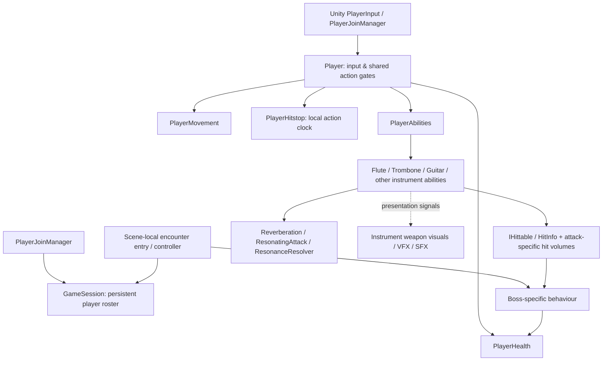

# Crescendo — Architecture and Collaboration Contract

**Status:** team baseline (v1)  
**Applies to:** Unity 6000.3.24f1 / URP, `Game50033`  
**Purpose:** a shared, practical architecture for six developers and their coding agents. This document describes both the desired long-lived design and how to adopt it from the existing project without a disruptive rewrite.

> **Principle:** stable responsibilities and contracts matter more than the number of classes. Build vertical slices, keep ownership localized, and introduce abstractions only when at least two concrete features need them.

## 1. Non-goals and invariants

- This is a **local** 2–4 player co-op boss-rush game. Do not design networking/replication infrastructure unless the scope changes.
- Shared player mechanics use **composition**. Instrument classes derive from `PlayerAbilities`; they do **not** derive from `Player`.
- The game is played on the **XZ plane** with a fixed, angled camera. Character/weapon sprites may be oriented in XZ. Do not silently switch to 2D physics or XY-space assumptions.
- The current player input behaviour (held abilities can retry, movement-facing fallback, dodge invulnerability through active dodge) is intentional until a design task changes it.
- Character animation is intentionally light. **Every instrument has a floating visual weapon component**, with instrument-specific motion carrying much of the attack readability. Keep the shared `Player` independent of the weapon animation implementation.
- Four people may attack simultaneously. Prioritize legible attack areas, target feedback, and restrained ambient VFX.
- **Not every architectural box needs a MonoBehaviour or manager.** Do not create empty systems just to match a diagram.

## 2. Responsibilities and dependencies



**Dependency rules:**

- **Player:** orchestrates per-player input, common action permissions, aim/target direction, and references to shared player components. No Guitar/Trombone/Flute conditionals.
- **PlayerMovement:** the sole authority for *physical player movement* via `CharacterController` (walking, dodge, and future skill-driven displacement). Ability scripts request motion; they must not move the player via `transform.position`.
- **PlayerHealth:** owns HP, damage acceptance/invulnerability, downed timer, automatic revival, and health-related notifications. Reviving needs no teammate input.
- **PlayerAbilities:** abstract contract (`TryUsePrimary`, `TryUseSecondary`, `TryUseDefensive`, `TryUseSpecial`, `Cancel`) and class-controlled restrictions (`BlocksMovement`, `BlocksDodge`, `BlocksAbilities`). `BlocksDefensive` defaults to `BlocksAbilities`; instruments can independently allow Defensive during cancellation windows without unlocking offensive inputs. Restrictions may change during individual attacks. `AnimationPhase` exposes `PlayerAttackPhase` (None/Windup/Active/Recovery), defaulting to None; it is a presentation view of ability timing, not a second timing authority. `MovementSpeedMultiplier` defaults to 1 and allows an ability to slow walking without modifying dodge or skill displacement.
- **Instrument implementation:** owns attack timings, cooldowns, hitboxes/projectiles, class resources, and its own weapon visual implementation (e.g. `GuitarWeaponVisual : FloatingWeaponVisual`). It should depend on the shared player API and shared combat contracts, not other instruments' internals.
- **GameSession:** persistent roster of participating `Player` objects, with registration/unregistration and roster notifications. It is not responsible for boss AI, lobby selection, or camera effects.
- **PlayerJoinManager:** creates/configures player instances and owns joins, leaves, and device pairing. Other gameplay code should **not** depend on this class merely to find players.
- **LobbyManager / character selection:** controls lobby selection and spawning of the chosen prefab. It owns lobby-only state; runtime player identity belongs to the surviving player instance. A ready player unreadies by standing in the cyan `UnreadyZone` ring (below the mic) for the countdown in `Assets/Tuning/Lobby/LobbyTuning.asset`, 2 s by default, shown above their head. `PlayerCharacterSelect.ReturnToSelection` releases their character and goes back to browsing with the cursor on it. Each pick spawns the player at their fixed slot point, `LobbyManager.spawnPoints` indexed by `playerIndex`. The points sit at the four room corners, matching the HUD panel corners and marked by a floor ring in that panel's accent colour, so nobody spawns where they unreadied. B/Q stays the character's Defensive ability after picking.
- **Encounter entry/controller (when added):** scene-local encounter setup, spawn points, fight start/end and win/loss conditions. Boss AI should be independent of lobby/scene transition implementation.
- **Boss-specific scripts:** targeting, movement, attack patterns and phase behaviour. Read active players from `GameSession` or context supplied by the scene entry; avoid hardcoded player GameObjects and `PlayerJoinManager` dependencies.
- **Presentation:** animation, floating weapons, VFX, SFX, HUD. Presentation listens to gameplay events or explicit calls. It must not define authoritative damage, cooldown, or hit outcomes.

Coupling to a fitting owner (e.g., boss → roster, Guitar → PlayerMovement) is acceptable. Do **not** add interfaces or an event bus just to eliminate every reference.

## 3. Scene and object lifetime

### Recommended baseline — multiple encounter scenes, persistent players

Use **one scene per independently developed boss encounter**. Maintain the current lobby-to-game flow while extending it to more encounter scenes:

```text
Lobby.unity -> Cutscene1.unity -> Game.unity (current first playable encounter)
                                      |
                                      +-> later Encounter_Boss02.unity, ...
```

- The existing `GameSession` plus `PlayerJoinManager` live on a persistent manager root. Joined player roots (with `PlayerInput`) also survive scene transitions. This retains device pairing, player indices, and selected instrument instances.
- **Current implementation uses `DontDestroyOnLoad` and ordinary scene loading.** Keep it for now. Separate boss scenes do **not** require a new `Core.unity` scene or mandatory additive loading. Additive loading is an option later for persistent shared environments or simultaneous streamed scenes, not a prerequisite.
- Bosses, arena geometry, hazards, scene lighting, arena-specific UI, and encounter scripts are **scene-local** and get destroyed when their encounter is unloaded.
- An encounter scene has one entry point (currently `GameSceneEntry` for `Game.unity`) that positions surviving players, restores input, and supplies encounter-specific references as needed. Don't repeat a `FindObject...` lookup every boss update.
- Do not serialize cross-scene references from encounter assets to persistent roots; resolve/inject them at runtime. Boss code can receive the roster/session via encounter initialization or a one-time lookup through the current player. No global singleton required.
- Define reset rules explicitly before a second fight exists: HP, cooldowns, active projectiles/REV entities, attack restrictions, and boss state must start in a known condition. Preserve device pairing and selected instrument.
- Keep existing `SceneNames` / Build Profiles accurate whenever a scene is renamed or added. If a boss scene is meant to work standalone in the Editor, provide test initialization rather than duplicating persistent managers in production prefabs.
- The team-wipe/defeat condition is a *game-design decision* and intentionally not prescribed here; downed players currently auto-revive on a timer.

### Lifecycle ownership reference

| State | Owner | Survives encounter scene change? |
|---|---|---|
| Device pairing, player index | `PlayerInput` / persistent player | Yes |
| Selected instrument / character identity | Player + character selection data | Yes |
| Player roster | `GameSession` | Yes |
| HP/cooldowns | Player components; reset at encounter boundary | Object persists; values reset by policy |
| Boss AI, phases, projectiles, arena hazards | Encounter scene | No |
| Lobby selection UI | Lobby scene | No |
| Weapon visuals | Instrument/player prefab | Yes; visuals reset with player |

## 4. Shared gameplay and combat contracts

### Runtime debug tools

`Assets/Gameplay/Debug/` owns `DebugMenu`, its UI Toolkit stylesheet/theme, `DebugPanelSettings` and `DebugMenu.prefab`. `GameSession` instantiates the serialized menu prefab once under the persistent session root. Session-owned plain `DebugState` holds global flags and uses the live read-only player roster for one-shot operations; it is neither a singleton nor a tuning asset. Scene transitions and menu visibility preserve state; a new session starts with cheats off. There is no development-build gate.

`DebugMenu` handles F1, mouse controls and pointer-over-panel combat suppression, running before `Player` input routing. It changes no gameplay clocks. `Player` suppresses only mouse-sourced Primary/Secondary input over the open panel. During initialization, a player still referencing `InputSystem.actions` receives a runtime copy, destroyed with that player. Replacing `PlayerInput.actions` clears its device pairing, so initialization preserves and restores the existing paired devices, control scheme, active action map and activation state across that swap. The project-wide asset keeps an unfiltered, enabled UI map so an unpaired mouse can operate the menu with four gamepad players; gameplay continues reading each player's paired action asset. Player health combines global invincibility with existing immunity; movement skips charge gating/spending under Infinite Dodge while retaining normal state gates and recharge.

Concrete `PlayerAbilities` implementations read protected `IgnoreCooldowns`, omit deadline checks/writes when enabled, and override `ClearCooldowns()` to clear only their cooldown deadlines. Enabling No Cooldowns calls that hook immediately for every player; registration also clears deadlines for newcomers while the cheat is active. Current Guitar, Flute, Trombone and training implementations support it. This must not cancel attacks, reset combos, refill other resources or bypass ability phases. Disabling the cheat does not restore previous deadlines. `DebugState.HealToFull()` heals living players only. Runtime attack visualization currently covers Guitar melee impacts and Strum sweeps.

`HitboxDebugOverlay` is a non-interactive UI Toolkit element beneath the menu controls. The menu adds it to the persistent document and refreshes it in `LateUpdate` while `DebugState.ShowHitboxes` and at least one supported category filter are enabled. Closing the panel does not hide it. It reads `CombatHurtbox.Active`, skips player-owned shapes and disabled target behaviours, and calls the public geometry-only `GetWorldCapsule(out bottom, out top, out radius)`. Orthographic projection produces the exact capsule silhouette from the shared world endpoints/radius, including rotated/scaled anchors and sphere degeneracy. It does not inspect sprites, VFX, colliders or rendered pixels. Shapes render over scenery, independently of lighting/Gizmos, without raycasts, damage calls, runtime materials or renderer-feature changes. Unsupported perspective cameras and offscreen shapes are skipped. `DebugVisualizationTuning` beside the debug code owns presentation settings through `Assets/Tuning/Debug/DebugVisualizationTuning.asset`, referenced by `DebugMenu.prefab`. All-build runtime paths use the same implementation. The player category is described below.

`DebugAttackSnapshot` is a readonly geometry packet: origin, locked direction, inner/outer radius, angle, world stretch axis/factor and optional inner/outer sweet-spot boundary. It also captures world time and the active encounter scene. Gameplay may call `GameSession.Debug.RecordAttack(...)` at query resolution; recording is gated by enabled categories and never calls VFX or applies damage. Guitar Primary/Defensive record once in shared sweep resolution; Special records once at its impact. Misses are recorded too. `DebugState.AttackSnapshots` is a read-only view, and `ExpireAttackSnapshots(lifetime)` removes expired/unloaded-scene data even when the overlay is hidden. Closing the menu preserves filters and snapshots; a new session resets them.

The overlay renders the same four-degree annular-sector polygon and stretch used by projected hurtbox queries. Primary’s sweet band is outer, Defensive has none, and Special uses a full circle with an inner sweet circle. The latter represents the ground-projected target-centre rule, not silhouette-overlap eligibility. `ShowPlayerAttacks` and `ShowSpecialZones` independently select orange attack regions and purple sweet regions; both default enabled. When both are shown, the purple fill replaces the orange fill in that band. All impact outlines are dashed and the menu identifies them as past impacts. Debug tuning owns their 0.12-second default world-time lifetime and dash spacing. Hitstop, recovery and later player movement cannot extend damage or move recorded geometry. These previews show the attack footprint used by projected combat; legacy physics broadphase capsules/vertical tolerances are not separate debug volumes. Other instruments are not integrated.

`DebugProjectileTrace` is a reusable data buffer for capsule-swept projectiles. `BeginFrame()` clears prior geometry, `AddSweep(inside, outside, radius, motion)` records query inputs, `CompleteFrame(allowedFraction)` supplies the accepted wall-stop fraction, and `Finish()` converts the last frame into a historical snapshot. The trace holds a generic Behaviour owner and its encounter scene, with a read-only sweep view. `DebugState.RecordProjectileTrace()` registers enabled player-attack traces without duplicate entries; `ProjectileTraces` exposes a read-only view. The existing expiry pass also removes unloaded-scene traces and completed traces after the same authored snapshot duration.

Guitar Strum creates its trace lazily when visualization is enabled, reuses its buffer each step, and records exactly the capsules already queried for initial overlaps and movement/growth casts. It adds no physics calls and does not modify contact sorting, deduplication, wall selection or damage. The fraction is published before damage callbacks, so cancellation during a hit still leaves coherent debug geometry. Hidden traces clear without collecting queries; toggling on during flight resumes sampling. Normal completion and component disable finish the last frame. The overlay projects each accepted swept capsule as the convex hull of its four endpoints expanded by the query radius, including sphere/collinear degeneracies. Rounded contours target 0.2 panel pixels of arc chord error. Coincident query volumes are emitted once to avoid degenerate vector tessellation. A single nonzero fill per trace avoids alpha stacking among overlapping spokes; solid outlines expose the actual live primitives. Completed traces use the same dashed snapshot style as melee, and live data from previous rendered frames is skipped. Geometry buffers are reused, colours/opacity/dashes come from existing debug tuning, and the renderer has no concrete instrument dependency. Strum retains world-space collider detection; unlike melee’s opt-in projected combat, screen overlap is not sufficient for a hit.

`PlayerHurtbox` owns the shared player combat geometry and is exposed as `Player.Hurtbox`. It requires the existing CharacterController and references `Assets/Tuning/Players/PlayerHurtboxTuning.asset`; the C# tuning type lives beside it. `GetWorldCapsule(out bottom, out top, out radius)` reads the current controller radius, total height, centre and transform scale, then scales the effective capsule uniformly about its bottom surface. The default factor is 0.9; the source controller and its settings are never changed. The wider absolute X/Z transform scale sets the world radius, Y scale sets height, and height is clamped to at least the diameter before shrinking, so sphere cases and the feet anchor remain consistent. `IsAvailable` requires the hurtbox and source controller to be active/enabled. The base Player prefab supplies it to Guitar and Flute variants; the standalone Trombone prefab wires the same tuning asset. No `IHittable` implementation, Rigidbody or additional physics collider is added to players.

Incoming attacks must query the combat capsule of roster participants via `Player.Hurtbox`, respecting `IsAvailable`, and call `Player.Health.TryTakeDamage(...)` for accepted contacts. Health retains ownership of immunity/downing/revival; damage geometry must not silently fall back to the larger world-collision controller. Enemy attack/damage integration is not implemented by this geometry/preview change.

The overlay receives the session’s live read-only player roster from `DebugMenu`, with `ShowPlayerHurtboxes` defaulting enabled. It projects those same combat capsules in cyan, using the common capsule renderer and `playerHurtboxColor` from debug tuning. It draws them after attack overlays for visibility and skips disabled/unavailable actors, downed players and all immunity sources, including the global Invincibility cheat. This matches current damage acceptance without duplicating health rules in the geometry component. Enemy and player hurtbox filters remain independent; closing F1 preserves both and a fresh session resets them.

### Player API

Prefer these existing public boundaries over inspecting private state or finding objects:

- `Player.Movement`, `.Health`, `.Hurtbox`, `.Abilities`, `.Hitstop`, `.Session`, `.Character`, `.PlayerIndex`, `.AimDirection`, `.GetAttackDirection(...)`.
- `Player.GetAttackDirection()` acquires aim on demand from the shared origin (player position plus 0.25 Y). The parameterized overload preserves the caller's launch origin and its existing signature; range, masks, attack volume and REV arguments no longer filter automatic selection. Paired gamepad right-stick input overrides Auto and maps X/Y to world X/Z through its existing deadzone. Neutral stick selects the nearest active, living boss or training target, with movement-facing fallback. Paired keyboard/mouse input defaults to Auto; `Player/ToggleAimMode` (Left Shift) toggles Manual mouse projection onto the horizontal plane through the player's feet. The per-player mode survives downing, disable/re-enable and scene changes with that Player instance. Invalid manual projection falls back to facing rather than snapping to a boss. No global input devices are read. `Player.Update` handles the toggle and updates presentation `AimDirection` after movement using the shared manual-input calculation. Manual uses the current paired mouse/right-stick direction. Auto presentation follows a cached eligible boss/dummy each frame and refreshes nearest-target selection at the authored interval (0.1 s by default), or immediately when a still-existing cached target becomes invalid; no-target results also retain the deadline. Invalid or absent targets fall back to movement-facing. Cached target state is per-player and cleared on disable; no per-frame target search or physics query is introduced. `TryGetManualAimDirection` is shared with attack requests, so projection/deadzone/fallback logic is not duplicated. Resting Guitar presentation and character left/right flipping consume this state in both modes; active attack directions remain locked and `GetAttackDirection` still performs a fresh selection for each automatic activation. Guitar's four actions, Cymbals' strikes/throw/Crash/Parry and training attacks keep activation-time locks. Parry stays locked through raising and holding. Flute keeps its launch origins and calls; projectile range/collision and REV interaction remain attack-owned.
- `PlayerAimTuning` keeps the Auto Facing Refresh Interval, cursor textures and pixel hotspots centralized in `Assets/Tuning/Players/PlayerAimTuning.asset`, wired on the base Player prefab and standalone Trombone prefab. The paired KB/M player alone sets the native cursor (`pointer.png` in Auto, `target.png` in Manual), only when the texture/hotspot changes or ownership resumes. Gamepad players never overwrite it. Input loss, disable and application focus loss restore the system cursor. SVG sources and 32×32 readable Cursor-imported PNGs live together under `Assets/Art/UI/Cursors`; UI cursor presentation does not control aiming or hit detection.
- `Player.CanMove`, `.CanDodge`, `.CanUseAbilities`, `.CanUseDefensive` are the shared action gates; instruments determine their own temporary restrictions via `PlayerAbilities`.
- `PlayerHitstop` is a small shared component on `Player.prefab`, exposed through `Player.Hitstop`. `Request(duration)` keeps the longer remaining pause; `IsStopped` reports it. `ActionTime` / `ActionDeltaTime` form a per-player action clock. `Player.Update` ticks it once before input and movement, consuming only the paused portion of a frame and never catching up discarded time. It uses scaled Unity delta time so an ordinary game pause also stops this clock/countdown. It never changes global `Time.timeScale`. `Clear()` ends the pause without rewinding action time. Player down/disable and component disable clear it; Guitar cancellation also clears its own pause. No singleton, event bus or `IHittable` change is involved.
- Hitstop blocks new movement/dodge/ability actions through existing Player gates. Movement still recharges dodge charges using world time, but skips physical movement while stopped and uses action time for skill-displacement timestamps. Guitar phase timestamps use action time while cooldown/combo deadlines remain on world time. Weapon interpolation uses action delta time: the impact pose can display on its request frame, followed by held frames. Guitar smear poses use the same action clock and hold during hitstop. Existing independent world effects (including impact particles and launched projectiles), health/revival/immunity timers, enemies and other players keep their normal clocks. Hitstop itself grants no invulnerability. Future melee classes opt in by requesting a pause and using the local clock for their action/animation; ranged attacks must not request attacker hitstop.
- `PlayerMovement` owns dodge charges, the active dodge, and physical movement. `TryStartDisplacement(direction, distance, duration, easing, delay = 0)` requests one XZ displacement; it returns false if movement/controller is unavailable or another dodge/displacement is active. The optional delay aligns a lunge with an attack windup on the same per-player action clock. Standalone movement components without `PlayerHitstop` retain the world-time fallback. `Tick(deltaTime, canMove, movementSpeedMultiplier = 1)` combines permitted walking at the supplied multiplier (nonnegative) with a skill's fixed displacement, including during its delay. An ability that requires a full movement lock must still set `BlocksMovement`; the multiplier does not bypass that gate. Dodging suppresses walking for its entire duration, including its final tick. `CancelDisplacement()` stops pending or active motion. Downing, disabling the player/movement, or disabling the controller cancels it. A displacement does not grant invulnerability.
- `PlayerAnimation` is presentation-only, wired on the base player prefab with its child Animator, CharacterController, PlayerHitstop and shared `Assets/Tuning/Players/PlayerAnimationTuning.asset`. It samples actual horizontal controller velocity after player movement, sends `Moving` and run-threshold-normalized `Speed` parameters, and holds Animator playback during local hitstop. The controller owns immediate Idle/Walk/Run transitions and held attack-pose overrides; it does not control movement or damage. `PlayerAnimation` samples after Guitar abilities (execution order 200), forwards their `AnimationPhase` as the integer `AttackPhase`, and updates that parameter even when hitstop holds playback so the impact pose can appear on its first stopped frame. Other instruments retain locomotion until they opt into this shared property. Animation clips under `Assets/Gameplay/Players/Animation/` author the sprite sequences and 8 FPS playback: Idle 0–1, Attack 4–5, TakeDamage 6–7, Walk 8–11, Run 12–15, Jump 24–31 and Death 36–39. Only Idle/Walk/Run loop. Additional single-frame AttackWindup, AttackActive and AttackRecovery clips hold literal sheet frames 4, 2 and 0. Any State transitions select these poses from the phase parameter; completion or cancellation returns to Idle, then normal movement selection. Guitar Primary, Secondary and Special derive the phase from their existing snapshotted windup/active durations and action-clock timestamps, without changing gameplay timing or movement. The original Attack/TakeDamage/Jump/Death clips remain prepared without gameplay transitions. Thresholds are centralized in the tuning asset; frame sequences and playback timing are edited through Unity’s Animation window. Existing character tint and projected sprite material are preserved. Sprite flipping follows the screen-horizontal component of `Player.AimDirection`, with hitstop retaining its existing animation freeze.

- `PlayerHealth` owns damage/downing/revival. Do not implement alternative HP fields inside instrument classes.
- `PlayerAbilities` methods are invoked while held where applicable. Individual abilities own whether a press, hold, charge, or release is meaningful. Extend input exposure through `Player` only when needed; do not read other players' global input assets.
- `Player` applies character art/tint only to its serialized avatar renderer. Instrument weapon renderers retain their own art and materials. Older standalone prefabs without that reference fall back to their first child sprite renderer.

### Dodge presentation

- `Players/Dodge/PlayerDodgeVFX` is wired with the avatar renderer and `Assets/Tuning/Players/PlayerDodgeTuning.asset` on the shared Player prefab; variants inherit it. The separate Trombone prefab is deferred. `PlayerMovement.DodgeStarted(direction)` fires once after an accepted activation spends a charge and establishes `IsDodging`; failed activation publishes nothing. `DodgeEnded(completed)` fires after the final actual move with true, or on cancellation with false. These notifications do not depend on incoming attacks or successful evasion. Movement owns collision, charges, direction and progression; it does not reference the VFX component.
- The VFX start handler requests the existing `PlayerHitstop` when enabled (default 0.05 s). Its request occurs before the movement tick, so startup movement/dodge progression and player animation hold; `IsDodging` invulnerability covers the startup freeze as well as the original travel duration. Recharge and health/world clocks continue. No global time scale or second hitstop implementation is introduced. The component never clears unrelated attack hitstop when disabled; normal player/down/disable cleanup retains ownership of the shared clock.
- `LateUpdate` samples actual XZ trajectory segments after movement and animation. Distance-spaced samples capture only avatar sprite/flip/transform; `DodgeAfterimage.shader` matches the avatar projection and original mesh depth, discards source RGB and draws unlit player-colour silhouettes from sprite alpha. Its ordinary transparent pass keeps effects full-resolution, depth-tested against the composed scene, without changing `PixelArtRendererFeature`. No colliders, animation, weapon snapshots or shadow casting are attached. The renderer's transparent mask must continue to include the avatar visual layer. The VFX component owns bounded per-player pools of twice the per-dodge maximum (default 16 slots / eight emissions), warmed on enable and rebuilt when the active scene changes or the configured count changes at activation. Long-lived overlapping snapshots recycle old slots; no unbounded allocation occurs during dodges. Pool roots belong to the active encounter scene, outside the persistent player hierarchy, and are hidden/destroyed on player disable/destruction. Cancellation stops emission; natural completion still samples the last moved segment, including low-FPS complete-in-one-tick dodges.
- `PlayerDodgeVFX` also warms one cached `DodgeFlash.prefab` instance inside its scene-local pool root, independent of afterimage emission. `DodgeStarted` captures world origin, actual dodge direction and action time; the existing startup hitstop therefore holds visible pose zero before progression begins. `LateUpdate` orients the quad along the direction projected into the gameplay camera plane, keeps it at the activation origin plus optional forward drift, and supplies a pose index (0–3) and independently configured colour/opacity through a property block. Four held shader shapes span the configured total duration (default 0.12 s); fade is sampled at each pose's start. The flash is white/grey by default, uses no texture, collider or runtime mesh allocation, and performs no gameplay decisions. Its prefab's MeshRenderer uses `DodgeFlash.mat` / `DodgeFlash.shader` on `PixelWorldVFX`, preserving pixelation and world occlusion through the existing render path. The shader projects depth onto the quad pivot's horizontal plane to prevent floor clipping in north/south directions, and disables batching because that depth calculation requires object-local geometry. Natural completion of dodge travel does not extend the flash; action-clock expiry, cancellation, downing, component disable and scene-pool rebuild clear it. Rapid activations reuse the same instance; different players retain independent instances/clocks. No shared player prefab, movement, i-frame or input edits are required for this second stage.
- Shockwaves are presentation-only records owned by `PlayerDodgeVFX`: two bounded slots capture activation world origin, world-time start and duration. `Active`, `Shockwaves` and `Tuning` are internal read-only views for the renderer; there is no global manager/singleton, gameplay dependency or separate effect GameObject. Owners register on enable and unregister on disable; disable and active-scene transitions clear records. Cancelling dodge travel leaves an already-emitted world-time ripple to expire normally. Ring shape/strength curves are evaluated from the owner's tuning when rendering, so world-time expansion continues during player-local hitstop. Additional activations recycle the next slot instead of growing storage.
- `DodgeShockwaveRendererFeature` is a separate feature subasset on `PC_Renderer.asset`, with serialized material and pixel-renderer references. It injects one combined pass at `BeforeRenderingPostProcessing`, after gameplay transparencies, for orthographic base Game cameras. Full-resolution avatars/weapons/afterimages and low-resolution world effects are already composed; Screen Space Overlay UI is composited later and is excluded. World-space/camera-space UI remains part of gameplay. The feature reads `PixelArtRendererFeature.Resolution` (a read-only view of its existing serialized grid), snapshots at most eight live visible wave records per camera, and binds per-pass data without modifying a shared material. Screen centres use the camera's GPU view/projection and the graphics API's texture Y convention. Radii/thickness are authored in world units and converted to screen-circular orthographic radii. The shader evaluates its ring field per reference-grid cell, sums/caps distortion in reference pixels, rounds to integer offsets and point-samples the composed image, retaining full-resolution sprite detail within translated cells without blur or colour mixing. The active pass uses one temporary colour target and updates `cameraColor`, avoiding a copy back; no graph pass or target is created when waves are absent, expired, disabled, off-screen or zero-strength. The two-per-owner/eight-total bound assumes the existing four-player limit. Default duration/radii/thickness/strength/combined cap and expansion/falloff curves live only in the dodge tuning asset. The existing pixel render pipeline is otherwise unchanged; coordinate concurrent edits to the shared pixel feature and renderer asset.
- `PlayerMovement` also references the shared `PlayerDodgeTuning` directly for `rechargeTime` (default 7 seconds per charge, clamped to at least 0.01 s). It schedules the first deadline when leaving full charges and advances deadlines by that interval without restarting them when the second charge is spent. Unmigrated prefabs without the asset, including standalone Trombone, retain their serialized `dodgeRechargeTime` fallback. VFX availability does not govern charge recovery.
- All authored dodge presentation settings live in `PlayerDodgeTuning`: independent hitstop/afterimage toggles, count, spacing, lifetime, colour multiplier, opacity, fade curve, optional opacity steps and shared material. `fadeSteps = 0` applies the clamped curve directly, while positive counts retain stepped opacity; the current asset uses smooth cubic decay `(1 - progress)^3`, a 1 s lifetime and 0.75 starting opacity. Snapshots keep independent born times/lifetimes/colours; fades use world time and continue through local hitstop. The directional startup flash and distortion shockwave are integrated. Dodge presentation does not change movement distance, speed/easing, charge recovery or input.

### Guitar abilities and weapon presentation

- Shared `PlayerHealth.GrantAbilityInvulnerability(duration)`, `ClearAbilityInvulnerability()` and `AbilityInvulnerabilityRemaining` provide one active ability's immunity deadline on the player's action clock, so local hitstop holds immunity along with that action. Clearing/expiry/Health disable affects only this deadline; dodge and world-time revival immunity remain independent. `IsInvulnerable` combines all three sources. Abilities own cancellation cleanup; health does not depend on concrete instruments.


- `GuitarTuning` holds Attack, Secondary, Special, Weapon and VFX sections in the single shared asset `Assets/Tuning/Instruments/Guitar/GuitarTuning.asset`. `GuitarAbilities`, `GuitarWeaponVisual` and `GuitarVFX` each reference it directly. The asset contains configuration only, including the impact prefab asset; per-instance renderer/transform wiring and runtime state remain on components. Missing tuning is reported once when a component enables, and that component disables instead of silently using fallback values.
- `FloatingWeaponVisual` defines only `Cancel()`. Pose APIs stay instrument-specific until a second weapon needs the same operations.
- `GuitarAbilities` owns one private `GuitarAction` enum (`None`, `Primary`, `Secondary`, `Defensive`, `Special`) as its sole current-action state. `IsAttacking`, `IsStrumming` and `IsDefending` are derived views. `Update()` dispatches via this enum to `UpdateSweep` (shared Primary/Defensive), `UpdateSecondary` or `UpdateSpecial`. Activations set the action explicitly; completion and `Cancel()` return it to None while retaining their existing cleanup and combo/cooldown rules. `PlayerAttackPhase` remains derived from the existing action clock and snapshotted durations, never independently stored. Cooldowns, combo/empowerment data and one-shot hit/release flags remain separate runtime data. Shared player contracts, serialized references, authored tuning and prefab wiring are unchanged.
- Guitar selects `_SpriteFlatDepth = 2` in its per-renderer property block: each visible vertex is projected along the viewing ray onto a world-upright plane through the grip, with its normal following the camera's horizontal viewing direction. This supplies obstacle depth independently of the camera-facing artwork. Modes 0/1 retain original-mesh/XZ-projected depth for other consumers. The original mesh still casts shadows; weapon shadow reception uses the same upright-plane world positions as obstacle depth. Damage geometry is independent. Weapon depth excludes floors entirely as described below; upright geometry can still intersect obstacles.
- `GuitarAbilities` owns a three-strike Primary string. Each held-input retry can start the next strike after recovery; a pause resets the string and finishing the third strike adds the combo cooldown. Each strike requests and locks `Player.GetAttackDirection()` on activation, locks dodge/other abilities, and requests a delayed lunge from `PlayerMovement`. Guitar overrides `MovementSpeedMultiplier` with Attack's `movementSpeedMultiplier` (default 0.2) throughout Primary's windup, active and recovery. `Player` forwards the active ability's multiplier into movement each tick, otherwise using 1. Primary allows walking at this reduced speed even when lunge distance is zero, and independently adds the original fixed-direction lunge during Active. Finishing, cancelling, downing or disabling restores the normal multiplier. Secondary selects its own independently tuned multiplier.
- Secondary Strum stays in `GuitarAbilities`: it snapshots aim, slows walking and briefly locks dodge/other actions, launches a `GuitarStrum`, and refreshes the combo continuation window without changing the pending Primary step. It requests a backward displacement from `PlayerMovement` opposite the captured aim, delayed until release and lasting through the active phase. Windup, Active and Recovery are separate durations: the wave launches at Active's start, the strum/backstep starts during Active, and Recovery settles the weapon before actions unlock. Projectile lifetime remains independent. Distance and easing are Secondary tuning fields; cancellation/downing cancels this motion through the existing shared path. Secondary's `movementSpeedMultiplier` (default 0.2) applies throughout all three phases, including casts with zero backstep distance. Live slowed walking adds to the original captured-direction backstep through shared movement, preserving wall collision. Completion, cancellation, downing and disable release the slowdown. It has its own cooldown and can occupy the finisher's Primary cooldown. `IsAttacking` covers all three actions; `IsStrumming`, `HasEmpoweredAttack`, `SpecialCooldownRemaining` and `SecondaryCooldownRemaining` expose the small additional state. Empowerment is granted on launch, independent of hits, has no expiry, does not stack, and is consumed only when a Primary or Special activation succeeds. The snapshotted multiplier applies to that entire strike, including sweet spots; a missed strike still spends it. `Cancel()` clears empowerment and any active action, without destroying previously launched waves.
- `GuitarStrum` owns scene-local projectile movement, snapshotted geometry/damage, swept curved-front queries, per-wave target deduplication and wall/lifetime termination. Distance, duration and movement/growth/fade curves define its expansion and slowdown. Queries sweep the combined per-spoke translation and radial growth, comparing collision fractions before accepting enemy hits, so an expanding front cannot skip a target or pass through a thin wall between frames. It ignores players, pierces enemies once each, resolves the nearest wall before targets behind it, and continues after its caster is downed. Instantiate it without parenting to the persistent player. `GuitarStrumVisual` receives that same geometry and updates the leading crescent from that same radius and tip taper, plus a cosmetic fragmented tail. Mesh topology and buffers are reused across frames. It never applies damage. The visual uses its dedicated `GuitarStrum.mat` / `GuitarStrum.shader` on `PixelWorldVFX`, with warm body/rim/tail colours, hard colour bands, moving chunky tail breakup and stepped opacity supplied by the shared tuning asset. Its bright rim is cosmetic for this uniformly damaging projectile; Primary's smear shader is unchanged. Neither Secondary nor its wave implements REV/RES yet. Special uses its own slowed-walking settings without a displacement; Defensive follows the same movement convention.
- Defensive is a standalone melee sweep/backstep in `GuitarAbilities`, using the same full-sector projected hurtbox/legacy-collider resolution as Primary with independent `GuitarTuning.defensive` geometry, damage, timings, hitstop, motion and weapon curves. There is no sweet spot, empowerment consumption or projectile. Each target takes normal damage once at the smear's onset. Activation captures aim, immediately grants immunity through Windup plus Active, and schedules backward displacement opposite aim over Active through `PlayerMovement`; slowed walking remains available throughout all phases. `IsDefending` and `DefensiveCooldownRemaining` expose state. The shared `Player.CanUseDefensive` gate and Guitar's `BlocksDefensive` allow cancellation of Primary/Secondary/Special Windup and Recovery, never Active, dodge, hitstop, downed state or Defensive itself. Input routing retries Defensive before held offensive actions. Dodge cancellation is unchanged. Primary Windup cancellation preserves the pending index; Primary Recovery cancellation advances it, including spending the finisher cooldown. Defensive refreshes the continuation window at start/end. Already-spent cooldowns/empowerment are not refunded; pending empowerment is preserved. Interrupted Secondary never launches if cancelled before release; launched waves survive. Special indicators and pending movement are cancelled. A zero backstep distance still permits the attack and immediate immunity.
- Defensive reuses the shared attack animation phases and weapon sweep poses. `GuitarVFX.SetDefensiveFlash(bool)` owns a serialized avatar-renderer reference on the Guitar variant and blends repeated white overlays through the existing `_FlashColor`/`_FlashAmount` shader properties without changing texture alpha or player tint. Flash timing uses the player action clock and checks the health-owned ability deadline; expiry at Recovery, cancellation, downing, input loss and component disable clear it. It is presentation-only and never grants immunity. Its smear's sweet boundary is beyond the full sector, giving one body colour. All new authored values live in `Assets/Tuning/Instruments/Guitar/GuitarTuning.asset`; no shared shader, input asset, base prefab or other instrument migration is required.
- Special Overhead Smash stays in `GuitarAbilities`. `TryUseSpecial()` snapshots aim/timing/radii, consumes pending Secondary empowerment, resets the Primary string and starts a world-time cooldown. It allows independently tuned slowed walking without a lunge and blocks dodge/other abilities. Its automatic windup defaults to 0.9 s, Active to 0.12 s, Recovery to 0.45 s and cooldown to 12 s. `Update()` keeps the indicator a fixed distance along the captured direction from the moving player until impact (default 80% through Active), then freezes its world position and resolves the full circle once. Authored hurtboxes use the existing camera-projected outer overlap query; the sweet-spot test drops `CombatHurtbox.WorldCenter` vertically onto the impact plane, retaining world X/Z and ignoring height, and requires that ground footprint inside the inner radius. It does not project along camera rays. The legacy collider fallback likewise tests its bounds centre in X/Z. `WorldCenter` exposes the same anchor-transformed authored centre used by capsule construction. Default damage is 8 / 16 normal/sweet; Secondary's renamed `empowermentMultiplier` (migrated from `primaryMultiplier`) applies to Primary or Special, including sweet spots. Legacy targets without authored hurtboxes retain a collider fallback; player targets and disabled authored hurtboxes are excluded. Contact requests the maximum normal/sweet local hitstop once; downing/cancellation stops the attack immediately. No REV/RES behaviour is implemented here.
- `GuitarWeaponVisual.SetSmashPose()` receives the authoritative phase/progress and impact fraction. It pulls the guitar backward near shoulder height, holds that pose with a strengthening stepped rotational tremble, then performs a fast overhead downstroke and settles through recovery. Backward offset, hold height and shake angle/frequency live in Special tuning. Shake is a temporary presentation offset sampled from the player action clock, pauses with hitstop and disappears on leaving Windup without changing the stored pose or damage geometry. Motion angles, grip heights and easing live in Special tuning. The resting material draws the raised windup behind character bodies; downstroke/recovery use the attack material. `GuitarVFX.ShowSmashIndicator()` and `PlaySmashImpact()` are presentation-only: a reusable world-positioned quad draws the exact supplied radii with `GuitarSmash.mat` / `GuitarSmash.shader`, using hard warm colour bands and four held impact poses. Its `SmashImpact` renderer is on `PixelWorldVFX`; impact lifetime uses the attacker action clock and pauses with hitstop. The circle remains fixed at impact even while its persistent parent moves. Per-instance mesh/material wiring belongs to the Guitar prefab; all authored tweaks stay in the shared Guitar tuning asset.
- Damage resolves once across the complete XZ annular sector at a configurable normalized Impact Fraction of Active (default 0.5), shared in timing with the initial crescent. Primary and Defensive have independent fractions; Special keeps its existing impact timing. `GuitarAbilities` snapshots the current player position after movement, aim, full angles, inner/outer radii, sweet-spot radius and arena-space stretch, and passes that same data to presentation. Overlapping radial capsule queries cover the sector; contact filtering prevents capsule thickness from extending its XZ boundaries. Targets are deduplicated per strike, so one target can take three hits across a full string. There is no dependency on the sprite transform, VFX mesh or physics trigger callbacks. Later lunge travel and afterimages do not move or repeat the damage area. Each strike has a reach multiplier (defaults 1 / 1 / 1.4); reach and sweet-spot radius scale together. Attack settings define a fixed world-XZ stretch axis and Depth Stretch multiplier (default world Z and 1.5). Hit queries and gizmos stretch the sector along that axis; contact filtering applies its inverse before checking radius/angle and sweet-spot membership. The inner hole and sweet-spot boundary stretch with the outer edge. The attack geometry remains fixed in world space for the strike. Targets with `CombatHurtbox` use the projected query described below; the remaining targets keep world-space detection. The outer radial region applies a configurable sweet-spot damage multiplier. After both projected and legacy targets are resolved, a successful Primary requests the maximum applicable normal/sweet hitstop duration from the current combo entry (normal/sweet defaults: first 0.04 / 0.06, second 0.05 / 0.075, third 0.06 / 0.09 seconds) once for the sweep. Requests do not sum across targets, do not occur on misses or Secondary/projectile hits, and do not interrupt resolving the other targets in that impact. `IHittable`/`HitInfo` remain unchanged; Primary has no REV/RES interaction.
- `GuitarWeaponVisual` handles a wielded shoulder pose, anticipation, swing and recovery. The resting guitar body starts opposite movement facing, then applies Weapon's `restingAngleOffset` (default 20 degrees) clockwise in the gameplay camera plane. Left-facing directions mirror that offset counterclockwise, including left-side diagonals; exactly vertical screen-facing directions use clockwise (with a small numerical tolerance around zero horizontal component). `shoulderLift` is removed. Idle geometry projects the smoothed visible direction back onto XZ along view rays, keeping the underlying weapon axis consistent without a second smoothing step. Attack poses retain their original angles and smoothing. Its grip anchor sits near the player. Weapon tuning separates `restingGripPoint` (default `(0, 0.1)` in the grey neck) from `spriteGripPoint` (Inspector label Attack Grip Point, original `(0, 0.45)` outside the sprite). Windup blends the grip using the existing position response; Active uses the exact external pivot. The sprite offset and shader pivot always receive the same interpolated value. Returning to idle blends back to the neck. Follow-through is retained between combo strikes and blends back to the shoulder pose when the string finishes, times out or is cancelled. The sprite faces the camera and rotates in that plane; sweep angles still come from XZ gameplay. It uses `2DSpriteMat`: `_SpriteRotation` and `_SpritePivot` rotate the visible camera-facing image about the grip, while `_SpriteFlatDepth` selects the depth policy described above. All three properties default to zero, preserving existing avatar projection and depth. The weapon no longer faces its transform toward the camera or applies a camera-depth lift. The weapon sprite stays on the full-resolution `SpriteVisual` layer. `GuitarPlayer.prefab` wires authored resting and attack materials. Idle uses `Art/GuitarRestingWeapon.mat`, a copy of `2DSpriteMat` at render queue 2449 with ForwardLit ZWrite disabled; avatar sprites at queue 2450 then cover the whole resting guitar wherever they overlap. This intentionally applies to other players' bodies too. Obstacle depth testing uses the upright plane and excludes floors. Primary/Secondary poses and held follow-through use `Art/GuitarAttackWeapon.mat` at queue 2500 with ForwardLit depth writes off. Special retains the resting material through Windup, then uses the front attack material for Active/Recovery. Runtime code switches shared material references without cloning or mutating them.
- Strum uses `GuitarWeaponVisual.SetStrumPose(direction, phase, progress, vibrationElapsed, vibrationDuration)`. `GuitarAbilities` supplies its existing authoritative phase and elapsed Active/Recovery time; presentation introduces no independent attack clock. Windup moves the guitar across the torso into a fixed playing pose, mirrored left/right from captured aim. Active launches the existing projectile/backstep and begins screen-vertical sine displacement; its amplitude decays across Active plus Recovery using `(1 - normalizedTime)^strumDecay`. Recovery blends back toward the resting shoulder pose. Secondary tuning owns offset, grip point, angle, amplitude (0.04 world units, two authored pixels at 50 PPU), frequency (14 Hz) and decay (2); obsolete sweep angle/easing settings are removed. Vibration is applied as a fresh child offset after smoothing and final pivot rotation, so it stays camera-vertical without feedback or drift. The player action clock freezes it during hitstop; completion/cancellation clears the strum mode. Completing Secondary returns the visual toward rest even when a Primary combo is pending, without changing the pending combo step or empowerment. It retains the attack material throughout its phases. Presentation does not move the player or change damage timing.
- `GuitarVFX` receives the impact snapshot and immediately displays its full sector, followed by four timed, held poses: broad slash, follow-through, broken crescent and remaining streaks. `BeginSwing` now requires the swing's Active duration. It snapshots four positive pose durations by normalizing VFX frame weights and scaling their sum to that supplied duration. Serialized `frameDurations` weights migrate to `frameWeights`, preserving their existing proportions; those values are no longer seconds. The sequence starts at impact and can leave streaks into Recovery. Pose durations use the owning `PlayerHitstop.ActionTime` independently of rendering FPS, so the current mesh pose/lifetime holds during hitstop and resumes without catching up world time. Standalone VFX without that component retain world-time timing. Weapon motion remains continuous outside hitstop, while damage occurs only at the initial pose. `GuitarSmear.shader` uses hard body/sweet-spot color bands and clipped breakup rather than interpolated colors or alpha fading. The mesh uses the supplied stretch and the shader applies its inverse before measuring distance against the sweet-spot radius, using the same fixed impact origin and shape as damage. Each smear carries its own axis and inverse stretch in UV2, so overlapping effects do not share mutable shape parameters. The initial mesh has no separate reach, inner-radius or onset overrides; decorative edge clipping and subsequent afterimage shapes are presentation only. Pose 3 has a flat leading edge and a torn trailing edge in either swing direction. Each swing carries its own pose data, allowing independent overlapping effects. `GuitarVFX` owns/releases the runtime mesh; cancellation/disable clears it. Both it and the test dummy restore their native-backed property blocks in `OnEnable` so Play-mode script reloads cannot leave null blocks and flood the Console. Scene-local impact particles remain independent, and gameplay works with presentation disabled or absent.
- `Abilities/Guitar/Prefabs/GuitarPlayer.prefab` is a variant of the shared Player prefab with the placeholder `PlayerCombat` removed. `Character_Guitar.asset` selects it through the existing lobby flow. `Scenes/TestScenes/GuitarPrimaryTest.unity` provides three damage dummies and Guitar/Flute prefab overrides for local testing. `GuitarDamageDummy` is a feature-local test target, not a new combat contract.

### Cymbals Primary (five-hit combo)

- `CymbalsTuning` (`Assets/Tuning/Instruments/Cymbals/CymbalsTuning.asset`) holds a Combo section (per-hit timings, damage, lunge and hand motion; the hitting point; chaining) and a Weapon section (guard pose and motion easing). `CymbalsAbilities` and `CymbalsWeaponVisual` both reference it. `ComboSettings.GetHitPoint` is the only definition of the hitting point and is used by both damage and presentation.
- **Hitting point:** every strike lands at the same point, at `hitDistance` from the player along the strike's aim and `hitHeight` above the origin. `hitHeight` only places the visual. Damage is one vertical capsule of `hitRadius` at that XZ point, running from the player's feet up `hitColumnHeight`, so target height does not matter. It is read when the approach ends, after lunge movement. Trigger colliders are ignored, because they are detection or range volumes rather than bodies; Boss 1 has a 10-unit detection trigger. Targets are deduplicated per strike; player colliders are skipped. `IHittable`/`HitInfo` are unchanged, and Primary has no REV/RES interaction.
- **Strike phases:** windup, approach, follow-through, recovery. Damage resolves at the end of the approach. The lunge runs during the approach, so the player arrives as the hit lands. Movement and other abilities are blocked for the whole strike. Dodge is blocked only during the approach and follow-through, matching the GDD rule that a dash can cancel startup and recovery. A dash in recovery keeps the chain, so the next press continues with the next hit. A dash in windup aborts that strike, and the next press repeats the same hit. The chain survives while dodging and resets after `comboResetDelay`; finishing hit 5 adds `comboCooldown`. Holding Primary keeps chaining through the existing held-input retry. The aim is acquired once per accepted strike through `Player.GetAttackDirection()`.
- **Weapon visual:** `CymbalsWeaponVisual` drives two camera-facing cymbal sprites (one per hand) under the player prefab. The default chain is: right forward bash, left slash to right, right slash to left, left slash to right, both clash. Each hand's motion per hit is a start pose and an end pose, given as an angle around the player relative to the aim plus a distance. A swinging hand goes from where it is now to its start pose, sweeps in an arc to the hitting point, sweeps on to its end pose, then returns to guard. Swinging hands are placed without smoothing. On the impact frame `CymbalsAbilities` reports follow-through progress 0, so the cymbals render exactly on the hitting point as damage lands. During the clash, the cymbals sit `clashSpacing` apart sideways. Hands that are idle or not swinging ease towards a guard pose beside the facing direction. The sprites use `2DSpriteMat` on the `SpriteVisual` layer; the art is a 22×22 placeholder (`Abilities/Cymbals/Art/CymbalPlaceholder.png`, 50 PPU).
- **Slash trail and hit effect:** each cymbal has a `Trail` child (a `TrailRenderer` on `PixelWorldVFX`). `CymbalsWeaponVisual` emits it only while that hand sweeps through the approach and follow-through, and clears it when a new sweep starts. Trail time, widths and colour are in the Weapon section. The trail has its own material, `Abilities/Cymbals/Art/CymbalsTrail.mat` (`Sprites/Default`, unlit and vertex-coloured), separate from the hit-effect material, so the trail look can change without affecting hit effects. After each accepted `TakeHit`, `CymbalsAbilities` plays `combo.hitEffect` (`Assets/Tuning/Instruments/Cymbals/CymbalsHitEffect.asset`) at the target point nearest the hitting point. A hit's `bigHit` flag (set on the clash) selects the big-hit style. The impact strips are placeholders in `Abilities/Cymbals/Art`.
- `Abilities/Cymbals/Prefabs/CymbalsPlayer.prefab` is a variant of the shared Player prefab with the placeholder `PlayerCombat` removed. `Character_Cymbals.asset` selects it. `Scenes/TestScenes/CymbalsPrimaryTest.unity` is a copy of the Guitar test range with Cymbals players in every join slot. It also has a `Parry test turret` (`Abilities/Cymbals/Testing/CymbalsTestTurret`), test-only, that fires `CymbalsTestProjectile`s built like the boss projectiles (trigger sphere, no Rigidbody, `PlayerHealth.TryTakeDamage` on touching a Player, tagged `BossProjectile`).
- **Defensive, Parry:** a cone from the player's centre along the aim (`parry.coneAngle`, 60 by default, and `parry.range`), held for `parry.duration` (2 s). It acquires auto-aim once when the parry starts and retains that direction through both raising and holding.
  - **Input:** a fresh press only (`TryUseDefensive` ignores frames where it was also called the frame before), so holding Defensive never re-parries.
  - **Restrictions:** free movement, a dash ends it early, no other abilities while it is up. Blocked while a cymbal is thrown, a combo strike or Crash is active, or during the cooldown (`parry.cooldown`, 7 s from when the parry ends).
  - **Detection:** every frame, an overlap query (triggers included) around the player finds objects tagged `parry.projectileTag` (`BossProjectile`, in the project tag list), checks they are inside the cone on the ground plane, then deactivates and destroys them. It is a query, not a trigger collider, so it needs no Rigidbody, cannot be mistaken for an obstacle `BoxCollider` by bouncy projectiles, and catches projectiles already inside the cone at the press.
  - **Damage:** `PlayerHealth` is untouched. Parried projectiles never reach the body; hits from other directions and other damage still land.
  - **Reward:** the first parry of a press calls `AddCrashCharge()` `parry.crashChargeReward` times; more parries in the same press give nothing extra. Each parry plays `parry.parryEffect` (`CymbalsParryEffect.asset`, the hit effect without damage numbers) and pops both cymbals.
  - **Visual:** both cymbals held side by side at the hitting point, `cymbalSpread` apart and shaking (`shakeAmplitude`, `shakeFrequency`), via `CymbalsWeaponVisual.SetParryPose`. `CymbalsParryArcs` (presentation only) draws one arc along the far edge of the cone, the line of parry, which glows and dims (`glowRate`, `dimAlpha`, `glowWidth`) and flashes on a parry, using `CymbalsParryArc.mat`.
- **Body animation:** `CymbalsAbilities.AnimationPhase` maps its existing state to `PlayerAttackPhase` for `PlayerAnimation`: combo Windup/Approach+FollowThrough/Recovery and Crash Windup/Impact/Recovery map to Windup/Active/Recovery; the throw shows Windup, then None during the free-walking flight and Active for the recast dash; the parry shows Windup only for `raiseTime`, then None so the walk cycle plays during the hold.
- **Special, Crash:** a triangular shockwave with its tip at the combo hitting point, opening forward along the aim. Size is `crash.length` and `crash.width`.
  - **Input:** a fresh press only, using `Player.SpecialPressedThisFrame`, so holding the button never spends twice.
  - **Charges:** `maxCharges`, 2 by default, refilling one at a time every `rechargeTime`. `AddCrashCharge()` exists for the parry reward. A charge is spent at the slam, so a dash-cancelled windup is free.
  - **Blocked:** while a cymbal is thrown or a combo strike is active.
  - **Phases:** windup (cymbals rise overhead, dash-cancellable), slam plus `impactHold` (committed), then recovery (dash-cancellable).
  - **Area:** the `CrashVolume` child on the prefab has a convex trigger `MeshCollider` and a `ResonatingAttack` accepting Burst and Sustain. At the slam it is shaped into a triangular prism (feet to `hitColumnHeight`), placed at the tip and enabled for one query. Rebuilds happen only when the size changes, and the mesh is detached before editing, because editing a mesh the collider holds leaves the collider empty.
  - **Resonance:** teammates' Reverberations in the area are passed to `ResonanceResolver.TryActivate`, which checks the exact overlap; the player's own are ignored.
  - **Damage:** solid bodies are hit once each when `Physics.ComputePenetration` with the prism succeeds. Non-convex mesh colliders fall back to their centre being inside the triangle. Hits use the big-hit style.
  - **Visual:** `CymbalsCrashWaves` (presentation only) draws `waveCount` forward-pointing chevron waves on `PixelWorldVFX`. Their ends ride the triangle edges as they travel and fade, using `CymbalsCrashWave.mat`.
- **Secondary, Cymbal Throw:**
  - **Throw:** the right cymbal is thrown along the aim at release. The tuning is the Throw section of `CymbalsTuning`. The flight position is computed each frame by `CymbalsAbilities` from time, not physics, so damage and visuals always agree. On the way out, the outbound curve slows the cymbal to exactly zero at the apex (`range`). On the way back, the return curve speeds it up as it homes on the player's current position, and it is caught on arrival.
  - **Flight damage:** a damage column of `hitRadius` at the cymbal, hitting each target once on the way out and once on the way back.
  - **Restrictions:** during the short windup the player is rooted, and a dash cancels the throw. During flight the player moves and dodges freely and Primary is blocked, because the combo needs both cymbals.
  - **Recast:** one recast per throw, requiring a fresh press. Player retries Secondary every frame while held, so `CymbalsAbilities` tracks the last call frame, and the throw's windup deliberately leaves `BlocksAbilities` off so the held button keeps registering. Any recast spawns `throw.burstReverberation` at the cymbal and initialises it with the player and `burstStrength`.
  - **Recast dash:** if the recast is inside `apexWindow`, a total centred on the apex, the player also dashes to the cymbal with `TryStartDisplacement` and catches it. The dash checks the combo's hitting point every frame, hitting each target once per dash with the big-hit style. Dodge and abilities are blocked during the dash. Otherwise the cymbal continues its flight.
  - **Cooldown:** starts on the catch.
  - **Visual:** `CymbalsWeaponVisual` draws the thrown cymbal at the gameplay position. Spin uses `_SpriteRotation`, scaled by travel speed with a `minimumSpin` floor, so it visibly slows at the apex. The trail stays on, and the cymbal pulses `_FlashColor` while the apex window is open and the recast is unused. During the dash the left cymbal leads at the hitting point.

### Pixel-art world effects

- The full-resolution sprite path reserves material render queue **2500** for front weapon visuals on the configured sprite layers (including `WeaponVisual`). Resting weapon layers at queues 0–2499 draw first against obstacle-only depth; the remaining ordinary sprites draw into normal world/character depth, retaining mutual character occlusion. A final `Pixel Art Front Weapons` pass draws queue 2500 against obstacle-only depth, so entire weapons cover character bodies while non-floor opaque world geometry still occludes them. Opted-in materials must disable ForwardLit depth writes. All sprite groups draw exactly once and retain their original shaders, lighting and shadow-caster behaviour; shared source materials are unchanged. This adds one full-resolution depth texture and one depth-upscale pass. Subsequent transparent passes use character depth; front weapons intentionally do not contribute to that depth, so future full-resolution transparent effects require an explicit overlap policy.
- `PixelArtRendererFeature.weaponLayers` identifies resting weapon sprites that must bypass character/floor depth. `floorLayers` excludes designated floor objects from a separate low-resolution opaque depth pass (`Pixel Art Weapon Obstacle Depth`), preserving original regular/toon shaders and alpha clipping. Its depth is upscaled once for both weapon passes; ordinary world colour, outlines, character depth and later effects retain the floor. Resting/attack weapon materials must keep depth writes off. With no floor mask, weapon depth reuses ordinary world depth. The new `Floor` layer (14) is integrated only in `GuitarPrimaryTest`; it is included in world/toon masks to preserve that training floor's appearance. Other scenes require explicit floor assignment and appropriate world/toon masks; do not migrate scenes incidentally. The existing `WeaponVisual` layer (13) remains the configured weapon mask. This adds one low-resolution obstacle depth target/draw and one resting-weapon pass, shared by all players.
- `PixelArtRendererFeature` renders opaque world geometry and its outlines first, then selected transparent effects into the same low-resolution color target before nearest-neighbour upscaling. Transparent effects retain their materials and alpha blending, sort back-to-front, and test against opaque depth with depth writes disabled. They do not contribute to the outline calculation.
- `PixelWorldVFX` (GameObject layer 12) is the explicit opt-in layer for transparent effects that should pixelate. Assign an effect's renderer child to this layer; keep gameplay colliders on their existing layers. The Guitar `SlashSmear` is the initial user of this policy. Its impact particles have not been opted in.
- `PC_Renderer.asset` sets the feature's `transparentWorldLayers` to `PixelWorldVFX` and excludes that layer from URP's regular Transparent Layer Mask. Both masks must stay in sync so these effects render exactly once. Existing `Default` transparencies retain their full-resolution path.
- `SpriteVisual` (layer 11), other full-resolution transparencies and UI remain in their existing paths. Full-resolution transparent sprites draw after low-resolution effects; these two groups do not share one global transparent sorting order. Test their overlap when authoring new effects.

### Player shadow reception

- `PlayerShadowRendererFeature` on `PC_Renderer.asset` renders a separate main-directional-light shadow atlas for player receivers. URP's ordinary shadow map remains unchanged and includes weapons. The feature performs a separate native caster cull with `WeaponVisual` excluded, including eligible off-screen casters. It snapshots a filtered main-light GameObject culling mask for the camera/caster culls and restores the light immediately in finally blocks; scene-light configuration is not changed. The alternate pass deliberately uses GameObject/light culling masks rather than Rendering Layer mask tests, because native Rendering Layer tests override this exclusion. Custom light Rendering Layer shadow exclusions are therefore not mirrored by this player atlas. It uses each material's original ShadowCaster pass so sprite alpha clipping and dissolve remain intact. It follows the URP asset's cascade splits, light bias, shadow strength, fade and soft-shadow quality, with its own atlas resolution.
- `Assets/Tuning/Rendering/PlayerShadows.asset` owns the extra atlas resolution (default 2048) and excluded caster layer mask. Resolution is rounded/clamped to a power of two from 256 to 8192. The feature adds a second caster cull and depth-rendering pass; profile its named Render Graph pass (`Player Shadows (Without Weapons)`) when increasing atlas resolution or scene complexity. The pass restores camera view/projection, viewport and depth bias after rendering.
- `WeaponVisual` is GameObject layer 13, distinct from full-resolution avatar layer `SpriteVisual` (11) and low-resolution transparent effects layer `PixelWorldVFX` (12). The pixel-art feature includes both 11 and 13 in its full-resolution sprite mask. Put instrument weapon renderer children on 13; retain gameplay colliders and VFX on their existing layers. Guitar's sprite has real shadow casting enabled. Other instrument weapon renderers need the same explicit layer/cast setup when authored.
- `PlayerShadowReceiver.mat` is a copy of the shared sprite material with the local `_RECEIVE_PLAYER_SHADOWS` keyword enabled. The base Player and standalone Trombone prefab reference it, so Guitar/Flute inherit the receiver material; Trombone's animation setup is not changed. Ordinary sprite materials keep their existing lighting; opted-in weapon materials use the separate receiver map below. `PlayerShadows.hlsl` builds shadow coordinates and cascade selection from the interpolated original mesh position, matching the ShadowCaster geometry. The vertex and fragment variants both enable `_RECEIVE_PLAYER_SHADOWS` to carry that position; billboard positions/normals remain in use for lighting. Sampling the projected billboard surface against the original caster quad would cause false player self-shadowing. `PlayerShadows.hlsl` supplies only the main-light shadow lookup to URP lighting; it does not duplicate PBR or change additional-light shading. Players receive environment/character shadows but no shadows from excluded weapon layers, including other players' weapons. The world still receives the ordinary weapon shadows.
- The same `PlayerShadowPass` implementation runs a second configuration for weapon receivers, publishing an independent `_WeaponShadowMap` and its cascade/sampling data. `weaponAtlasResolution` defaults to 1024; `weaponExcludedCasterLayers` defaults to `SpriteVisual` (11) plus `WeaponVisual` (13), both authored in `PlayerShadows.asset`. The main directional light therefore casts environment shadows onto weapons, while character sprites and weapons still cast ordinary world/ground shadows. Filtering is layer-based: enemy sprite owners must use the excluded character visual layer if their shadows should also be filtered. No additional light or renderer-feature asset is created. This adds one native caster cull and atlas-render pass (`Weapon Shadows (Environment Only)`) beyond the existing player atlas; measure that pass before increasing resolution.
- `2DSpriteLit.shader` provides mutually exclusive filtered receiver variants: `_RECEIVE_PLAYER_SHADOWS` / **Exclude Weapon Shadows** for characters, and `_RECEIVE_WEAPON_SHADOWS` / **Environment Shadows Only** for weapons. The latter is enabled on Guitar's resting and attack materials. `PlayerShadows.hlsl` reuses the same sampling/cascade code with weapon-specific bindings; character receivers sample original caster-mesh positions to avoid billboard self-shadow artifacts. Weapon receivers in upright depth mode instead sample the same upright surface used for obstacle occlusion; their filtered atlas already excludes character/weapon casters, preventing self-shadowing. Other weapon depth modes retain original-mesh sampling. Lighting, normal world shadow casting, and the front/behind weapon draw order remain independent of receiver selection. Both atlas availability flags reset per camera and on disposal; empty filtered caster sets remain fully lit rather than falling back to the ordinary map.
- The feature resets availability per camera, including while disabled. A valid empty caster set is fully lit for realtime shadows; unsupported cameras or disabling the feature fall back to URP's normal map without reusing a previous camera's atlas. Baked shadow mixing remains native. Selective exclusion applies only to the main directional light's realtime shadows; additional point/spot-light shadows remain unchanged. This implementation targets the project's fixed, non-XR camera setup.

### Centralized tuning

- **All authored feature tweaks belong in ScriptableObject assets under the top-level `Assets/Tuning/` folder.** This includes gameplay values (damage, reach, timings, cooldowns, movement and health settings) and presentation values (weapon offsets, animation curves, smear pose durations, colors and effect sizes). Designers should not have to search prefab variants or scene instances to adjust these values.
- Group assets by ownership, for example `Assets/Tuning/Players/PlayerTuning.asset`, `Assets/Tuning/Instruments/Guitar/GuitarTuning.asset` and `Assets/Tuning/Bosses/Bone/BoneTuning.asset`. The Guitar and Cymbals assets exist; the Player and Bone paths are placement examples for future scoped migrations. Use separate assets for independently owned features to limit merge conflicts. A feature's related components can share one asset with clearly named serializable sections; do not require one asset per component or combine the entire game's settings into one asset.
- Keep the ScriptableObject C# type beside its owning feature code. Each consuming component holds a serialized reference to the appropriate asset. Avoid a global settings singleton, runtime asset searches or a generic configuration framework.
- The asset is the single source for each tuning value. Do not retain parallel prefab/scene values or silent fallback configurations that make it unclear which setting is in use. Preserve the current authored values when migrating a feature, including any intentional variant differences through explicitly assigned assets.
- Prefabs/scenes retain per-instance wiring such as renderers, transforms, colliders and scene object references. Runtime state such as HP, cooldown countdowns, combo progress and active effects stays on component instances; gameplay must not write that state into a shared tuning asset.
- Sharing configuration does not change responsibility: gameplay owns the authoritative hit area and timing, while presentation reads the supplied attack data. A VFX tuning section must not become an independent source for damage reach or sweet-spot thresholds.
- This is the convention for new work and explicitly scoped migrations. Guitar has been migrated and Cymbals was built on it; other existing components still store tuning on prefabs until migrated; this documentation does not authorize a project-wide rewrite or creation of placeholder tuning assets.

### Hits and damage

- `CombatHurtbox` is an opt-in 3D capsule definition on the same GameObject as an `IHittable`. Its optional Anchor is per-instance wiring. `CombatHurtboxTuning` assets under `Assets/Tuning/Combat/` own local-space Center, Radius and total Height along local Y. Anchor rotation and scale apply: radius uses the larger absolute X/Z scale, height uses absolute Y scale, and height below the diameter produces a sphere. The three Guitar test dummies share `GuitarTestDummyHurtbox.asset`. The capsule is mathematical geometry, not an additional physics collider; world collision is unchanged.
- Both Editor previews draw without selection and respect each viewport's Gizmos menu / `CombatHurtbox` toggle. Scene view draws the yellow 3D capsule; Game view draws its cyan orthographic silhouette only when the shared tuning asset's `showGameViewPreview` is enabled (default false). This debug flag does not affect queries or Scene-view drawing. The silhouette is moved along view rays towards the near plane to stay visible over artwork without changing its screen position. Disabled components draw neither. Both use the same world capsule endpoints/radius as hit detection, with no debug-only dimensions or runtime renderers.
- `CombatHurtbox.Active` exposes the enabled shapes; components register/unregister on enable/disable. This small registry is needed because world-space overlap queries would discard valid projected overlaps. It is not a combat manager and never applies damage. `TryOverlapSector(camera, origin, direction, innerRadius, outerRadius, angle, stretchAxis, stretch, out contact)` projects the 3D capsule endpoints onto the orthographic camera plane, retaining its round cross-section radius. This produces the exact projected capsule, including a circle when viewed along its axis. The existing capsule/triangle overlap then compares it to the annular sector, using the initial crescent's four-degree tessellation in camera-plane world units. The query requires an angled orthographic camera. Contact is returned on the attack plane for feedback. It does not inspect rendered pixels, artwork, VFX or world occlusion.
- Guitar Primary snapshots that registry once at impact, applies its mask and player exclusions, checks the normal band first, then the sweet band, and deduplicates with the same per-strike set as legacy hits. Overlap spanning both bands gives normal damage. Objects with a hurtbox cannot also use their world colliders for Primary damage, even when their hurtbox is disabled. Targets without one retain their existing queries. This is an explicit camera-dependent combat rule: depth-separated shapes can hit when their projections overlap. Only Guitar Primary currently adopts it; Secondary, other instruments, bosses and REV/RES are not migrated incidentally. Enemy owners must align their authored capsule with the vulnerable visible body, including any custom sprite projection.
- Reuse existing `IHittable.TakeHit(in HitInfo)` for world entities that accept player attacks. `HitInfo` presently carries attacker, damage and direction. `BaseBoss` and `TrainingDummy` provide current examples.
- `PlayerHealth.TryTakeDamage(int)` is currently the authoritative player damage API. Boss attacks should go through it or a **small adapter**, not subtract health privately. If richer hit data becomes necessary for players, evolve the shared contract deliberately instead of creating another parallel damage system.
- Each attack owns its spatial query/collider and **deduplicates targets within one swing/projectile**. An attack can hit multiple valid targets where the move requires it.
- Gameplay determines hit success, damage and timing. Hitstop, knockback, camera shake and hit flash are *consequences* triggered after an accepted hit; visuals must not determine whether a hit occurred.
- **Hit effects:** `Combat/HitEffects/HitEffect` is a ScriptableObject played after an accepted hit. Use one asset per weapon under `Assets/Tuning/Instruments/<Instrument>/`. It has rendering, impact sprite, particles, damage number and sound sections. Each section has a normal and a big-hit style; an empty big style falls back to the normal one. The attack calls `Play(HitEffectRequest)` with point, direction, damage and big, and nothing is returned to gameplay. Impact sprites and damage-number glyphs come from horizontal strip textures, cut into sprites at runtime and cached on the asset. `HitSpriteAnimation` and `DamageNumber` are spawned objects that face the camera, render with `HitEffects/Art/HitEffectUnlit.mat` (`Sprites/Default`, vertex-coloured) on `PixelWorldVFX`, and destroy themselves. They spawn into the active encounter scene, so a transition never carries them over. Sound uses a temporary 2D `AudioSource` with an optional mixer group. The asset is shared by every player, so it holds no per-player runtime state. The damage number shows the damage the attack dealt, because `TakeHit` does not report what the target received. Screen shake, hit-stop and rumble are intentionally absent: shake needs a camera listener, and global hit-stop affects all players, so both need a team decision. Cymbals is the first user; Guitar keeps its own `GuitarVFX` impact until a scoped migration.
- A shared hit resolver is warranted **only if** repeated cross-cutting rules (hitstop, hit immunity, knockback, reactions) are otherwise duplicated across several attacks. Do not create a generic combat framework preemptively.
- Use layers and collision masks deliberately. A visual arc is not the source of truth for the hitbox; it should communicate the authoritative attack area.

### Reverberation / Resonance

The existing implementation already has useful contracts; preserve and build on them:

- `Reverberation`: temporary world entity with creator, effect, strength, availability and expiry.
- `ReverberationEffect`: effect definition; effects determine the outcome when consumed.
- `ResonatingAttack`: a compatible attack volume linked to its owning player.
- `ResonanceResolver`: validates and consumes a compatible REV, executes the effect, emits a notification.
- `AttackTargeting.FindNearestTarget(origin)` considers active, living `BaseBoss` instances and damage receivers from the shared `CombatHurtbox.Active` list, including training dummies. It selects the nearest by target-root distance to the supplied origin, irrespective of range, masks or line of sight. Dead/disabled bosses remain excluded even when they have a hurtbox; disabled receivers, players and REVs are excluded. `IsValidTarget(target)` shares receiver/boss availability rules between selection and cached presentation, including disabled hurtboxes. `GetAimPoint(target, origin)` retains launch-height aiming through the visual/collider bounds, falling back to its transform without geometry. Manual aiming can still direct resonating attacks at REVs; compatibility and consumption remain owned by ResonanceResolver.
- A player should not consume their own REV under the current design. Instruments create/exploit REV through these shared systems rather than hardcoding teammate class checks.
- Adding a new instrument should normally mean adding instrument-local attacks/effect assets and using the existing shared contracts; not editing `ResonanceResolver` for every new skill.
- **Reverberation prefabs:** spawn one with `Instantiate(prefab, position)` then `Initialize(player, strength)`.
  - `Combat/Resonance/Prefabs/Reverberation.prefab` is the base: a trigger sphere with radius 0.5, a 2 s lifetime and `BurstEffect`, and no visual. Flute still spawns it directly.
  - `BurstReverberation.prefab` is a variant of the base. It adds a flat orange disc as its `visualRoot`, which is shown only while the Reverberation is available. Cymbal Throw spawns it.
  - `SustainReverberation.prefab` is a separate prefab with a purple disc; it is not a variant.
  - New Reverberation kinds should be variants of the base.

### Bosses

`BaseBoss` is currently a checkoff prototype; it combines targeting, health, visuals and a bone-projectile attack. **That is not the long-term shared boss API.** When implementing the next substantive boss feature:

1. Move Bone-specific attacks/graphics into a `Bone` boss feature directory.
2. Keep minimal common boss damage/health behaviour (possibly `BossHealth`) only if at least two bosses need it.
3. Have encounter setup supply the roster, or obtain it once from `GameSession`. Do not base the canonical roster on an arena detection trigger.
4. Separate boss attack behaviour from boss VFX, and keep each boss's balancing/configuration local.

Do this incrementally; do not break the existing checkoff demo just to reorganize code.

## 5. Feature-first folder structure

**Target structure, with `(new)` marking not-yet-required directories.** Existing paths are listed where important. Prefer moving feature-local assets together once ownership is clear; **do not move all assets at once.**

```text
AGENTS.md                            # Codex entrypoint (repository root)
README.md
docs/
  architecture_overview.md             # team-facing quick read
  agents/
    ARCHITECTURE.md                    # detailed reference for coding agents
Assets/
  Gameplay/
    GameSession.cs                      # existing; persistent player roster
    Players/
      Player.cs                         # shared player/input coordinator
      PlayerMovement.cs                 # walking/dodge/displacement
      PlayerHitstop.cs                  # per-player pause and action clock
      PlayerHealth.cs                   # downed/revive/health
      PlayerAbilities.cs                # abstract instrument contract
      FloatingWeaponVisual.cs          # common cancellation contract; concrete motion is instrument-specific
      PlayerJoinManager.cs              # join/leave/device pairing
      PlayerCharacterSelect.cs          # lobby-side player selection (existing)
      KeyboardGamepadBridge.cs          # existing input bridge
      Prefabs/
        Player.prefab                   # shared base prefab, owned centrally
        PlayerJoinManager.prefab        # persistent session root
      Abilities/
        Guitar/                         # abilities, tuning, weapon/VFX, Strum gameplay/visuals, test target
          Art/                          # guitar sprite and trail material
          Prefabs/                      # Guitar player variant and impact particles
        Cymbals/                        # CymbalsAbilities, CymbalsWeaponVisual, CymbalsTuning
          Art/                          # placeholder cymbal sprite, impact strips, trail material
          Prefabs/                      # Cymbals player variant (cymbal sprites and trail children)
        Flute/                          # existing Flute abilities, projectiles, flows
          Prefabs/
        Trombone/                       # target; currently Players/Trombone/
          Prefabs/
        Training/                       # temporary/testing abilities
    Combat/
      IHittable.cs                      # contains HitInfo today
      AttackTargeting.cs
      TrainingDummy.cs
      HitEffects/                       # HitEffect asset type, spawned impact sprite and damage number, shared unlit material and digit strip
      Resonance/
        Reverberation.cs
        ReverberationEffect.cs
        ResonatingAttack.cs
        ResonanceResolver.cs
        ...                             # specific effect types + prefabs
    Bosses/
      Shared/                           # (new if useful) cross-boss components
      Bone/                             # target for current Bone/BoneProjectile/assets
      <OtherBoss>/                      # one independently owned folder per boss
    Characters/
      CharacterDefinition.cs
      CharacterRoster.cs
      Data/                             # immutable-ish authored character definitions
    Lobby/                              # lobby UI, ready/start and selection rules
    Flow/                               # scene names, cutscene/transition utilities
    Game/                               # encounter entry / player spawn handoff
    UI/                                 # (new as needed) shared HUD and game UI
  Scenes/
    Lobby.unity                         # current path
    CutScenes/                          # current intro/placeholder cutscene
    Game.unity                          # current first playable encounter
    Encounters/                        # (new) later independent boss scenes
    TestScenes/                        # isolated integration/prototype scenes
  Art/                                  # shared art; per-feature art lives with feature
  Rendering/                            # global render features and shared shaders
    PlayerShadows/                      # alternate player shadow atlas, sampling, material and tuning type
  Settings/                             # Input Actions, URP and settings assets
  Tuning/                               # (new) central home for authored feature tuning assets
    Players/                            # shared movement, dodge and health tuning
    Instruments/                        # Guitar/, Cymbals/ tuning (Flute/, Trombone/ when migrated)
    Bosses/                             # one subfolder per boss
  Examples/                             # temporary examples, not production dependencies
```

**Folder conventions:**

- Keep **feature-owned code, prefabs, art, VFX and non-tuning data assets close together**. Tuning ScriptableObject assets are the deliberate exception: collect them under `Assets/Tuning/` while keeping their C# types with the owning feature. Reusable cross-feature code lives under `Combat`, `Players`, `Rendering`, etc. Don't build a top-level `Scripts/` dumping ground.
- One primary C# type per file, matching filename. Use the existing `Game50033` namespace; nested namespaces are optional when they add clarity. Namespace is **not required** to mirror folders.
- Name gameplay scripts by responsibility (`GuitarAbilities`, `GuitarWeaponVisual`, `GuitarVFX`), not by arbitrary `Manager`/`Helper` suffixes.
- **Base player prefab** contains only player-common components. **Every instrument prefab variant has a concrete floating weapon visual component** (e.g. `GuitarWeaponVisual : FloatingWeaponVisual`), and its own effects. The common abstract base is a script contract, not a component attached directly to the base prefab.
- Data assets (`CharacterDefinition`, `ReverberationEffect`, balancing configs) describe configuration. Avoid mutable global state in shared ScriptableObject assets.
- Shared art/shaders belong in `Art`/`Rendering`; a one-off Guitar effect belongs in Guitar's feature folder.
- Keep test scenes separate from the scene used for integration/demo. Test features independently without re-saving the team-owned gameplay scene unnecessarily.

## 6. Integration and ownership for six people

Assign a **human owner for each shared surface**; the names can change, the boundaries shouldn't. Multiple people can implement features inside their own directories simultaneously.

| Workstream | Primary modification area | Shared touchpoints requiring coordination |
|---|---|---|
| Player foundation & Guitar | `Players` shared code, `Abilities/Guitar` | `Player.prefab`, input actions, `GameSession` |
| Other instrument 1 | `Abilities/Flute` | shared combat contracts only when necessary |
| Other instrument 2 | `Abilities/Trombone` | shared combat contracts only when necessary |
| Bosses & arenas | `Bosses/<Boss>` and its encounter scene | `IHittable`, encounter entry |
| Combat synergy & VFX | `Combat/Resonance`, shared effects | `ResonanceResolver`, hit contracts |
| Lobby, UI & integration | `Lobby`, `Flow`, `Game`, `UI`, integration scene | `PlayerJoinManager`, build profiles, scene transitions |

These are **workstream suggestions, not assignments of specific teammates**. One integrator should own the integration branch/demo scene and take responsibility for detecting conflicts early.

### Cross-system change protocol

1. Describe the required change in terms of an API/behaviour, identifying who consumes it.
2. Have the owner of the shared component update it in a small PR/commit; provide a stub or adapter if needed to unblock others.
3. Each feature author integrates against that API in their own files.
4. If the change alters an established boundary, update this document in the same PR.
5. Integrate small, playable increments frequently. Do not leave weeks of unrelated feature branches diverging.

### Unity Git conventions

- Commit `.meta` alongside its asset, preserving GUIDs during moves. Never rely on another developer recreating an untracked folder or asset.
- Set up UnityYAMLMerge locally as described in `README.md`. It reduces, but does not eliminate, conflicts.
- Coordinate edits to the same `.unity`, base `.prefab`, `.inputactions`, shared `.shadergraph`, and Build Profiles. Prefer feature-specific prefabs and individual test scenes.
- Keep code reviews focused on architecture and behaviour rather than unsolicited wholesale formatting.
- Don't move or rename files while a teammate is actively modifying those same assets. Separate organization-only changes from gameplay changes where practical.

## 7. Implementation plan — adopt without stopping development

This is a **migration order**, not a required single giant refactor:

**Now (same day):**

1. Commit `AGENTS.md` and this document so agents and developers share the rules.
2. Designate ownership of `Player.prefab`, `PlayerJoinManager.prefab`, input actions, the shared combat contract, and the integration scene.
3. Keep the current `Lobby → Cutscene1 → Game` checkoff/demo flow running. Identify a minimal integration/playtest scene as the reference build.
4. New Guitar work goes straight into `Players/Abilities/Guitar` and its own variant/VFX assets. Use `IHittable`, `HitInfo`, and the existing Resonance APIs.

**As the next feature touches each area:**

5. Move `Players/Trombone/` into `Players/Abilities/Trombone/` with metadata intact, coordinated with the Trombone owner.
6. Move Bone-specific scripts, prefabs and animations under `Bosses/Bone/`; trim concrete attack logic out of `BaseBoss` only if the second boss exposes genuine duplication.
7. Add `Scenes/Encounters/` and a scene-local encounter entry/controller when a second boss scene is created. Preserve persistent players and device pairing across scenes; reset encounter-specific state explicitly.
8. Separate any presentation code that currently decides hits/damage, as it is encountered during VFX work.
9. Replace the current `BaseBoss` targeting dependency with a stable boss contract **only when** another boss implementation requires it.

**Do not do:** immediate global folder migrations, a new custom framework, duplicate skill/damage systems, or cosmetic refactors on every file. The goal is a durable direction that keeps the playable game moving forward.

## 8. Completion checklist for any feature

Before considering an agent-produced feature ready for the team:

- [ ] The feature's scripts/assets are in its owned folder; shared edits are justified.
- [ ] `.meta` files are included and prefab/scene references are valid.
- [ ] The relevant public contract is unchanged, or has been updated/documented and coordinated.
- [ ] It works in an isolated test scene **and** the integration scene where applicable.
- [ ] Multiplayer device pairing/input isolation still works when relevant.
- [ ] Encounter entry/exit, downing/reviving, cancellation, and re-entry do not leave stale objects or state where relevant.
- [ ] Visuals reflect the real hitbox and attack timing; SFX/VFX are not required for damage to happen.
- [ ] The developer reports exactly what was tested and any remaining Editor-only checks.
- [ ] `README.md` and this document are updated if controls, setup, public APIs, or architecture changed.

## 9. Architecture decision log

Keep this section short. When changing a rule, record *decision, reason, consequence*; do not silently let agent-generated code redefine the architecture.

| Decision | Reason / consequence |
|---|---|
| Composition for player; inheritance only for `PlayerAbilities` | Shared movement/HP remain stable; instrument work stays feature-local. |
| `GameSession` owns persistent player roster | Boss and UI don't depend on input-join mechanics. |
| One encounter scene per boss, persistent player objects | Reduces scene merge conflicts while preserving controller pairing. |
| Keep current DDOL-based transitions initially; additive is optional | Avoids a `Core.unity` rewrite during active integration. |
| Use existing `IHittable`/`HitInfo` and REV APIs | Prevents parallel implementations of combat and cooperation mechanics. |
| Every instrument has a floating weapon visual | `FloatingWeaponVisual` can define the shared contract; each class implements distinct movement/animation without instrument-specific code in `Player`. |
| Feature-first folders and prefab variants | Six developers/agents can work concurrently with fewer conflicting assets. |

**Document ownership:** project-wide architectural changes should be reviewed by the integration owner and affected feature owners before merging.
